# GranWarm Mamdani Fuzzy Inference System (27-Rule Specification)

## 1. Overview & Architectural Role

In the **GranWarm** serverless prewarming framework, the **Mamdani Fuzzy Inference System (FIS)** operates as the fast-loop controller (executing every 5–10 seconds). Unlike machine learning or long-horizon time-series forecasting models, which suffer under unpredictable flash crowds or non-stationary patterns, the Mamdani FIS enables **uncertainty-aware heuristic reasoning** based on immediate operational signals.

The controller evaluates four real-time inputs and recommends a continuous desired warm-capacity factor $P \in [0.0, 1.0]$ for each function. This recommendation is subsequently mapped into integer container allocations or fed into the slower Particle Swarm Optimization (PSO) granularity tree allocator.

```mermaid
flowchart LR
    subgraph Inputs [Workload & Platform Signals]
        R["Invocation Intensity R(t) ∈ [0, 1]"]
        T["Traffic Trend T(t) ∈ [-1, 1]"]
        C["Cold-Start Pressure C(t) ∈ [0, 1]"]
        M["Memory Pressure M(t) ∈ [0, 1]"]
    end

    subgraph MamdaniFIS [Mamdani Fuzzy Inference Engine]
        direction TB
        Fuzz["1. Fuzzification\n(trimf / trapmf)"]
        Rules["2. 27-Rule Evaluation\n(Min-AND Antecedents)"]
        Imply["3. Implication\n(Min Truncation)"]
        Agg["4. Aggregation\n(Max Union)"]
        Defuzz["5. Defuzzification\n(Centroid / CoG)"]
        Fuzz --> Rules --> Imply --> Agg --> Defuzz
    end

    subgraph Actuation [Capacity Sizing]
        P["Desired Warm Capacity\nP ∈ [0, 1]"]
        Scale["Scale to Pod Instances:\nround(min + P * (max - min))"]
        P --> Scale
    end

    Inputs --> Fuzz
    Defuzz --> P
```



- **Implementation Source:** [`controller/fuzzy/fuzzy_engine.py`](file:///c:/Users/bhavy/Desktop/Github/GitHub/GranWarm/controller/fuzzy/fuzzy_engine.py)
- **Configuration & Rules JSON:** [`configs/fuzzy_rules.json`](file:///c:/Users/bhavy/Desktop/Github/GitHub/GranWarm/configs/fuzzy_rules.json)
- **Test Suite:** [`tests/test_fuzzy.py`](file:///c:/Users/bhavy/Desktop/Github/GitHub/GranWarm/tests/test_fuzzy.py)

---

## 2. Input and Output Variables & Membership Functions

### 2.1 Input Variables

The fuzzy engine ingests four normalized variables:

1. **Invocation Intensity ($R \in [0, 1]$):** Current invocation frequency of function $f_i$ normalized relative to its observed historical maximum rate:
   $$R_i(t) = \frac{N_i^{\text{invocations}}(t - \Delta t, t)}{\Delta t \cdot R_{i,\max}}$$
   *(Default sample window $\Delta t = 10\text{ s}$)*

2. **Traffic Trend ($T \in [-1, 1]$):** First derivative/rate of change in invocation intensity:
   $$T_i(t) = R_i(t) - R_i(t - \Delta t)$$
   Positive values signify rising/surging traffic; negative values signify dropping load.

3. **Cold-Start Pressure ($C \in [0, 1]$):** Proportion of invocations that encountered cold starts over a rolling 60-second window $W$:
   $$C_i(t) = \frac{N_i^{\text{cold}}(t - W, t)}{N_i^{\text{total}}(t - W, t)}$$

4. **Resource Pressure ($M \in [0, 1]$):** Cluster-level physical memory utilization:
   $$M(t) = \frac{M_{\text{used}}(t)}{M_{\text{available}}}$$
   This global signal acts as a governor, dampening scale-up actions when the cluster is memory-constrained.

#### Input Membership Function Parameters

| Input Variable | Linguistic Term | MF Type | Parameters $[a, b, c, d]$ | Core Region $(\mu = 1.0)$ |
| :--- | :--- | :--- | :--- | :--- |
| **Invocation ($R$)** | `LOW` | Trapezoidal | `[0.0, 0.0, 0.15, 0.35]` | $0.0 \le x \le 0.15$ |
| | `MEDIUM` | Triangular | `[0.2, 0.5, 0.8]` | $x = 0.5$ |
| | `HIGH` | Trapezoidal | `[0.65, 0.85, 1.0, 1.0]` | $0.85 \le x \le 1.0$ |
| **Trend ($T$)** | `FALLING` | Trapezoidal | `[-1.0, -1.0, -0.5, -0.1]` | $-1.0 \le x \le -0.5$ |
| | `STABLE` | Triangular | `[-0.2, 0.0, 0.2]` | $x = 0.0$ |
| | `RISING` | Triangular | `[0.1, 0.4, 0.7]` | $x = 0.4$ |
| | `SURGING` | Trapezoidal | `[0.5, 0.8, 1.0, 1.0]` | $0.8 \le x \le 1.0$ |
| **Cold-Start ($C$)** | `LOW` | Trapezoidal | `[0.0, 0.0, 0.1, 0.3]` | $0.0 \le x \le 0.1$ |
| | `MEDIUM` | Triangular | `[0.15, 0.4, 0.65]` | $x = 0.4$ |
| | `HIGH` | Trapezoidal | `[0.5, 0.7, 1.0, 1.0]` | $0.7 \le x \le 1.0$ |
| **Memory ($M$)** | `LOW` | Trapezoidal | `[0.0, 0.0, 0.3, 0.5]` | $0.0 \le x \le 0.3$ |
| | `MEDIUM` | Triangular | `[0.35, 0.55, 0.75]` | $x = 0.55$ |
| | `HIGH` | Trapezoidal | `[0.65, 0.8, 1.0, 1.0]` | $0.8 \le x \le 1.0$ |

---

### 2.2 Output Variable: Desired Warm Capacity ($P$)

The output $P \in [0.0, 1.0]$ represents the normalized warm pool scale:

| Output Term | MF Type | Parameters $[a, b, c, d]$ | Core Region $(\mu = 1.0)$ |
| :--- | :--- | :--- | :--- |
| `VERY_LOW` | Trapezoidal | `[0.0, 0.0, 0.05, 0.2]` | $0.0 \le u \le 0.05$ |
| `LOW` | Triangular | `[0.1, 0.25, 0.4]` | $u = 0.25$ |
| `MEDIUM` | Triangular | `[0.3, 0.5, 0.7]` | $u = 0.5$ |
| `HIGH` | Triangular | `[0.6, 0.75, 0.9]` | $u = 0.75$ |
| `VERY_HIGH` | Trapezoidal | `[0.8, 0.95, 1.0, 1.0]` | $0.95 \le u \le 1.0$ |

#### Capacity Scaling to Kubernetes Containers
The defuzzified crisp output $P^{\text{fuzzy}}$ is scaled to the function's permitted minimum and maximum pod limits:
$$P_i^{\text{instances}} = \text{round}\left(x_i^{\min} + P_i^{\text{fuzzy}} \cdot (x_i^{\max} - x_i^{\min})\right)$$

---

## 3. Design Rationale & Pruning to 27 Rules

A full Cartesian product of linguistic terms yields $3 \times 4 \times 3 \times 3 = 108$ rules. Evaluating 108 rules at high frequency introduces redundant evaluations and potential rule conflict. GranWarm prunes this space to **27 rules** by enforcing four domain principles:

1. **Load-Proportional Scaling:** Base warm capacity should be commensurate with incoming request volume ($R$).
2. **Trend-Anticipatory Proaction:** Positive momentum ($T = \text{RISING}$ or $\text{SURGING}$) must warm capacity *ahead* of arrival, preventing the cold-start spike from forming.
3. **Cold-Start Error Feedback:** Persistent cold-start spikes ($C = \text{HIGH}$) indicate under-provisioning or concurrency saturation; the controller expands capacity even if traffic is currently steady.
4. **Resource-Constrained Moderation (Safety Valve):** When cluster memory is critical ($M = \text{HIGH}$), aggressive scaling is capped (e.g. from `VERY_HIGH` down to `HIGH`, or `MEDIUM` down to `LOW`) to avoid out-of-memory cascading crashes.
5. **Don't-Care Conditions (`—` or `null`):** For extreme conditions (such as a sudden surge or steady low traffic), certain variables (like memory or cold start) are unconstrained, firing with degree $\mu = 1.0$.

---

## 4. The 27 Mamdani Rules Specification

### 4.1 Complete Reference Table

| Rule ID | Invocation ($R$) | Trend ($T$) | Cold-Start ($C$) | Memory ($M$) | Target ($P$) | Operational Strategy |
| :---: | :---: | :---: | :---: | :---: | :---: | :--- |
| **1** | `LOW` | `FALLING` | `LOW` | — | `VERY_LOW` | **Idle Reclamation:** Dying traffic without cold starts; aggressively release idle containers. |
| **2** | `LOW` | `STABLE` | `LOW` | — | `VERY_LOW` | **Quiescent State:** Low steady traffic handled without friction; maintain minimal idle footprint. |
| **3** | `LOW` | `STABLE` | `MEDIUM` | `LOW` | `LOW` | **Minor Friction Compensation:** Low traffic with occasional cold starts; nudge warm pool up. |
| **4** | `LOW` | `STABLE` | `MEDIUM` | `MEDIUM` | `VERY_LOW` | **Conservative Hold:** Mild cold starts but memory is moderate; prioritize memory preservation. |
| **5** | `LOW` | `RISING` | `LOW` | `LOW` | `LOW` | **Early Ramp Detection:** Traffic begins upward climb; prewarm 1 container proactively. |
| **6** | `LOW` | `RISING` | `MEDIUM` | `LOW` | `MEDIUM` | **Proactive Cushioning:** Rising load is already triggering cold starts; ramp to medium. |
| **7** | `LOW` | `RISING` | `HIGH` | `LOW` | `MEDIUM` | **Lagging Cold Spike:** Low volume but high cold-start proportion; ramp to medium warm buffer. |
| **8** | `LOW` | `SURGING` | — | `LOW` | `MEDIUM` | **Flash Crowd from Cold:** Sudden burst under healthy memory; rapidly establish medium capacity. |
| **9** | `LOW` | `SURGING` | — | `HIGH` | `LOW` | **Constrained Flash Crowd:** Surge from cold, but cluster memory is high; clamp prewarming to low. |
| **10** | `MEDIUM` | `FALLING` | `LOW` | — | `LOW` | **Controlled Scale-Down:** Workload dropping from medium; smoothly step capacity down to low. |
| **11** | `MEDIUM` | `STABLE` | `LOW` | `LOW` | `MEDIUM` | **Nominal Steady State:** Moderate stable load running smoothly with healthy headroom; maintain medium. |
| **12** | `MEDIUM` | `STABLE` | `LOW` | `HIGH` | `LOW` | **Cluster Memory Shedding:** Steady load with no cold starts, but cluster memory is tight; shed to low. |
| **13** | `MEDIUM` | `STABLE` | `MEDIUM` | `LOW` | `MEDIUM` | **Equilibrium Holding:** Steady medium traffic with intermittent cold starts; sustain medium buffer. |
| **14** | `MEDIUM` | `STABLE` | `HIGH` | `LOW` | `HIGH` | **Concurrency Saturation Fix:** Steady traffic suffering severe cold starts; scale up to high. |
| **15** | `MEDIUM` | `RISING` | `LOW` | `LOW` | `MEDIUM` | **Smooth Load Growth:** Traffic growing from medium with no cold starts; keep solid medium pool. |
| **16** | `MEDIUM` | `RISING` | `MEDIUM` | `LOW` | `HIGH` | **Growth Under Pressure:** Rising traffic accompanied by cold starts; step up to high. |
| **17** | `MEDIUM` | `RISING` | `HIGH` | `LOW` | `HIGH` | **High Severity Growth:** Rising load producing excessive cold starts; scale urgently to high. |
| **18** | `MEDIUM` | `SURGING` | — | `LOW` | `HIGH` | **Aggressive Burst Prewarm:** Surging medium traffic with free cluster memory; allocate high capacity. |
| **19** | `MEDIUM` | `SURGING` | — | `HIGH` | `MEDIUM` | **Dampened Burst:** Surging medium traffic under cluster memory stress; dampen allocation to medium. |
| **20** | `HIGH` | `FALLING` | `LOW` | — | `MEDIUM` | **Post-Peak De-escalation:** Heavy load decreasing without latency penalty; step down to medium. |
| **21** | `HIGH` | `STABLE` | `LOW` | `LOW` | `HIGH` | **Peak Sustained Operating:** Heavy traffic handled stably; maintain high warm capacity. |
| **22** | `HIGH` | `STABLE` | `MEDIUM` | `LOW` | `HIGH` | **Heavy Load Maintenance:** Peak traffic with slight cold-start rate; maintain high warm capacity. |
| **23** | `HIGH` | `STABLE` | `HIGH` | `LOW` | `VERY_HIGH` | **SLA Emergency Scaling:** Heavy traffic in cold-start crisis; push to absolute maximum (very high). |
| **24** | `HIGH` | `RISING` | — | `LOW` | `VERY_HIGH` | **Expanding Super-Peak:** Traffic exceeding historical norms; maximize warm capacity pool. |
| **25** | `HIGH` | `RISING` | — | `HIGH` | `HIGH` | **Memory-Clamped Super-Peak:** Expanding super-peak under memory strain; clamp recommendation to high. |
| **26** | `HIGH` | `SURGING` | — | `LOW` | `VERY_HIGH` | **Extreme Flash Crowd:** Maximum surge with memory available; open full throttle (very high). |
| **27** | `HIGH` | `SURGING` | — | `HIGH` | `HIGH` | **Host Protection Flash Crowd:** Extreme surge but cluster memory exhausted; clamp to high to avoid crash. |

---

### 4.2 Breakdown by Operational Regimes

#### 1. Low Load Regime ($R = \text{LOW}$, Rules 1–9)
- **Primary Goal:** Conserve idle resources while ensuring functions do not freeze during cold wake-up.
- **Rules 1 & 2** enforce aggressive deallocation down to `VERY_LOW` ($P \approx 0.05 - 0.15$) when traffic is flat or dropping.
- **Rules 5, 6 & 7** use the rising trend $T = \text{RISING}$ to detect early ramps, raising capacity to `LOW` or `MEDIUM` before cold starts breach SLA.
- **Rules 8 vs. 9** showcase the memory dampener: a surge under healthy memory commands `MEDIUM`, but under memory exhaustion ($M = \text{HIGH}$), it is throttled to `LOW`.

#### 2. Medium Load Regime ($R = \text{MEDIUM}$, Rules 10–19)
- **Primary Goal:** Provide steady throughput and prevent latency degradation during organic workload transitions.
- **Rule 11** anchors the normal steady state at `MEDIUM` ($P \approx 0.5$).
- **Rule 14** addresses concurrency saturation: even if traffic volume is only moderate, if cold-start ratio is high ($C = \text{HIGH}$), warm capacity is upgraded to `HIGH`.
- **Rules 18 vs. 19** throttle incoming surges from `HIGH` down to `MEDIUM` if cluster memory exceeds safety thresholds.

#### 3. High Load Regime ($R = \text{HIGH}$, Rules 20–27)
- **Primary Goal:** Protect SLA latency targets and eliminate cold starts during heavy enterprise workloads.
- **Rules 21 & 22** keep warm capacity locked at `HIGH` ($P \approx 0.75$).
- **Rules 23, 24 & 26** escalate to `VERY_HIGH` ($P \approx 0.90 - 1.0$) whenever heavy traffic encounters high cold starts, expanding growth, or sudden surges.
- **Rules 25 & 27** provide platform fault tolerance: when the cluster is running out of physical RAM ($M = \text{HIGH}$), recommendations are clamped to `HIGH`, preventing node kernel OOM kills.

---

## 5. Mathematical Execution & Inference Pipeline

The engine evaluates rules via the standard Mamdani process across a discrete universe of discourse $u \in [0.0, 1.0]$ with resolution $N = 201$:

```
u_output = np.linspace(0.0, 1.0, 201)
```

### Step 1: Input Fuzzification
For each input $x \in \{R, T, C, M\}$, calculate membership degrees using:
- **Triangular Membership (`trimf`):**
  $$\mu(x; a, b, c) = \max\left(0, \min\left(\frac{x - a}{b - a}, \frac{c - x}{c - b}\right)\right)$$
- **Trapezoidal Membership (`trapmf`):**
  $$\mu(x; a, b, c, d) = \max\left(0, \min\left(\frac{x - a}{b - a}, 1, \frac{d - x}{d - c}\right)\right)$$

### Step 2: Antecedent Conjunction (Min-AND)
For each rule $k \in [1, 27]$, its firing strength $w_k$ is the minimum of its active antecedents:
$$w_k = \min\big(\mu_{R_k}(R), \mu_{T_k}(T), \mu_{C_k}(C), \mu_{M_k}(M)\big)$$
*(If an input is marked as don't-care `—`, its $\mu$ is taken as $1.0$).*

### Step 3: Implication (Mamdani Min Truncation)
Each rule's output membership function curve $\mu_{P_k}(u)$ is truncated by its firing weight:
$$\mu_{\text{rule}_k}(u) = \min\big(w_k, \mu_{P_k}(u)\big), \quad \forall u \in [0, 1]$$

### Step 4: Aggregation (Max Union)
All individual rule outputs are aggregated into a single combined fuzzy curve:
$$\mu_{\text{agg}}(u) = \max_{k=1\dots 27}\big(\mu_{\text{rule}_k}(u)\big)$$

### Step 5: Defuzzification (Centroid / Center of Gravity)
The crisp recommendation $P^{\text{fuzzy}}$ is calculated via the center of mass:
$$P^{\text{fuzzy}} = \frac{\sum_{j=1}^{N} u_j \cdot \mu_{\text{agg}}(u_j)}{\sum_{j=1}^{N} \mu_{\text{agg}}(u_j)}$$

If no rule fires ($w_k < 10^{-6}$ for all $k$) or $\sum \mu_{\text{agg}} = 0$, the controller defaults to a neutral safe fallback of $P = 0.5$.

---

## 6. Test Cases & Verification

The rule base is verified in [`tests/test_fuzzy.py`](file:///c:/Users/bhavy/Desktop/Github/GitHub/GranWarm/tests/test_fuzzy.py) against key invariants:

1. **Rule 1 Verification (Quiescent Low Traffic):**
   - Inputs: $R=0.05, T=-0.8, C=0.05, M=0.2$
   - Expected Output: $P < 0.20$ (`VERY_LOW`).
2. **Rule 26 Verification (Flash Crowd Surge):**
   - Inputs: $R=0.95, T=0.9, C=0.3, M=0.1$
   - Expected Output: $P > 0.80$ (`VERY_HIGH`).
3. **Memory Dampening Invariant (Rule 26 vs. Rule 27):**
   - Given identical workload ($R=0.9, T=0.9, C=0.3$), increasing memory pressure from $M=0.10$ to $M=0.95$ strictly lowers $P$ ($P_{\text{high\_mem}} < P_{\text{low\_mem}}$).
4. **Range Guarantee:**
   - Evaluated across 500 Monte Carlo pseudo-random input quadruples; $P$ is strictly bounded in $[0.0, 1.0]$.
