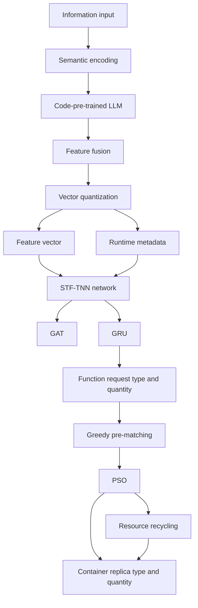

# electronics

# MDPI

## Article

# **WPPSO: A Container Management Method Based on Workload Prediction and Particle Swarm Optimization for Serverless Computing**

**Hanzhi Xu** 1, **Zhan Zhang** 1ID, **Decheng Zuo** 1,*ID, **Dongxin Wen** 1, **Dawei Chen** 2 and **Feng Xia** 2

---

1 Faculty of Computing, Harbin Institute of Technology, Harbin 150001, China; hzxu@stu.hit.edu.cn (H.X.); zhangzhan@hit.edu.cn (Z.Z.); wdongxin@hit.edu.cn (D.W.)

2 Shandong Province Key Laboratory of Independent and Reliable Computing Technology and Equipment, Chaoyue Technology Co., Ltd., Jinan 250104, China; chendw@chaoyue.com.cn (D.C.); xiafeng@chaoyue.com.cn (F.X.)

* Correspondence: zuodc@hit.edu.cn

## **Abstract**

Serverless computing has emerged as a prominent research focus in cloud computing because it provides infrastructure-transparent development and elastic resource management. However, this computing paradigm still faces the inherent challenge of cold start. Existing approaches have two major limitations: insufficient workload prediction accuracy and inefficient allocation of reusable container replicas to incoming function requests. To address these challenges, we propose a container scheduling approach based on Workload Prediction and Particle Swarm Optimization (PSO), named WPPSO. WPPSO first leverages a code-pre-trained large language model (LLM) to extract intrinsic function features and then uses a spatio-temporal fusion-based temporal neural network (STF-TNN) to predict serverless workloads. It subsequently employs a greedy algorithm to construct a high-quality initial matching state and uses PSO to refine the container scheduling strategy. Finally, WPPSO introduces a hierarchical container recycling mechanism to reduce idle resource waste. Extensive experiments show that WPPSO reduces startup latency by up to 72.2% and memory footprint by 63.4% compared with the native Knative platform. Compared with RainbowCake, WPPSO achieves a 15.6% lower mean startup latency without statistical significance and a statistically significant 31% reduction in idle memory consumption.

## **Keywords:** serverless computing; container scheduling; cold start; workload prediction; greedy algorithm; particle swarm optimization

---

## 1. Introduction

Academic Editor: George Angelos Papadopoulos

Received: 11 April 2026  
Revised: 20 May 2026  
Accepted: 27 May 2026  
Published: 8 June 2026

**Copyright:** © 2026 by the authors. Licensee MDPI, Basel, Switzerland. This article is an open access article distributed under the terms and conditions of the <u>Creative Commons Attribution (CC BY) license</u>.

### **1. Introduction**

With the rapid development of cloud computing, the computing paradigm has gradually shifted from traditional physical servers and virtual machines to platform-as-a-service (PaaS) and function-as-a-service (FaaS) models [1,2]. Serverless platforms automatically handle hardware deployment, server operation, resource scheduling, and elastic scaling, allowing developers to focus mainly on business logic [3]. When a function request arrives, the platform allocates a suitable container to provide the required runtime environment. After execution, the container resources can be reclaimed, thereby improving resource utilization [4]. Containerization packages applications together with their runtime libraries, dependency files, and configuration information [5]. Compared with virtual machines, containers are lightweight, easy to deploy, and scalable, which makes them widely used in

---

Electronics **2026**, *15*, 2519
https://doi.org/10.3390/electronics15122519

*Electronics* **2026**, *15*, 2519 2 of 28

serverless computing <u>[6]</u>. However, containers still cannot be started instantaneously <u>[7]</u>. A cold start occurs when the platform has to create a new container and prepare the runtime environment after receiving a function request <u>[8]</u>. Since many serverless functions are executed much faster than their container initialization time, cold starts may substantially degrade user-perceived latency, especially in latency-sensitive scenarios such as finance and real-time services <u>[9,10]</u>.

Existing mainstream serverless platforms such as Knative <u>[11]</u> and OpenFaaS <u>[12]</u> are committed to addressing this issue, among which the most widely adopted solution is the mechanism of container replica pool (CRP). It pre-constructs and maintains a set of ready-to-serve warm container instances, allowing direct allocation of available containers upon request arrival, thereby avoiding container creation from scratch and corresponding environment initialization <u>[13]</u>. Such a group of container replicas is defined as a CRP. Many studies leverage approaches such as time-series prediction and workload pattern mining to predict function invocation volumes and load peaks in advance, and proactively scale and pre-provision instances before requests arrive <u>[14]</u>. Container replicas are then scheduled based on the expected incoming load within a future time window, combined with scheduling strategies including locality-aware scheduling and resource affinity scheduling. These methods further reduce extra delay caused by scheduling and network transmission. However, tackling the cold start problem in serverless computing via the CRP mechanism still faces the following two critical challenges:

Firstly, existing workload prediction approaches in serverless computing suffer from insufficient accuracy, as they ignore the intrinsic features of functions <u>[15,16]</u>. They only focus on the temporal patterns of function arrivals and predict future invocations by fitting the invocation regularity of functions over a recent period. The intrinsic features, such as task-processing behaviors, runtime environments, and dependencies with other functions, are correlated with function arrival times or execution durations, which leads to low accuracy in predicting the load distribution of functions <u>[17]</u>. Moreover, numerous variables may be associated with the load, making it challenging to capture their specific quantitative relationships via simple statistical methods. Secondly, how to assign container replicas to the predicted upcoming function requests is a critical issue. Since different container replicas may support different language runtimes and dependency files, they must be allocated to appropriate function requests <u>[18]</u>. Yet this is not a trivial matching problem. In conventional container orchestration frameworks, such as K8s <u>[19]</u> and K3s <u>[20]</u>, each container provides a runtime environment for only one function. Such one-to-one allocation makes each container-function assignment affect the feasible choices and matching cost of the remaining requests. This matching process can incur a chain effect, which not only prolongs the startup latency of subsequent functions, but may also prevent functions with special dependencies from being matched in time when their only compatible containers are occupied. Therefore, an effective method is needed to derive a batch-level matching scheme between containers and function requests, so that more requests can be served by suitable reusable containers.

To address these challenges, we propose a container management method named WPPSO, which combines Workload Prediction with an improved Particle Swarm Optimization (PSO) algorithm. For workload prediction, WPPSO uses a code-pre-trained LLM to extract intrinsic function characteristics from source code, runtime configuration, and runtime metadata. These features are then combined with historical request arrival patterns and fed into a spatio-temporal fused temporal neural network to predict the type and quantity of incoming function requests in a future time window. For container scheduling, WPPSO combines a greedy strategy with discrete PSO to match predicted requests with appropriate container replicas. The greedy algorithm provides high-quality initial

https://doi.org/10.3390/electronics15122519

*Electronics* **2026**, *15*, 2519 3 of 28

solutions, while PSO further searches the solution space to improve the matching quality. In addition, WPPSO downgrades or recycles low-hit-rate container replicas according to a three-layer container structure, reducing resource waste caused by idle containers. We conduct extensive experiments on real-world datasets to evaluate cold-start mitigation, resource utilization, and workload prediction accuracy.

In summary, the main contributions of this paper are as follows:

- We propose a workload prediction method based on a spatio-temporal fused temporal neural network. It extracts intrinsic function characteristics via an LLM and uses them as additional information for workload prediction.
- We propose a batch-level matching method between function requests and container replicas. It combines a greedy strategy with PSO to improve the matching quality between predicted requests and reusable containers.
- We conduct extensive experiments on real-world datasets. Compared with mainstream platforms, WPPSO reduces startup latency by up to 72.2% and decreases CRP memory footprint by 63.4%.

## 2. Background and Motivation

The core execution unit of the serverless architecture is the function, which acts as the minimum independent execution unit that carries business logic [21]. Each function corresponds to a specific business capability and encapsulates complete code logic, runtime dependencies, resource configurations, and triggering rules. It possesses the core characteristics of being stateless, event-driven, on-demand instantiation, and resource-isolated [22]. In the serverless architecture, functions do not occupy resources persistently. They are dynamically allocated and launched by the cloud platform only when triggered by events. Resources are released immediately after execution, and both the runtime state and resource allocation of functions are fully managed by the underlying platform. If users intend to invoke functions within the serverless platform, they must ensure that the functions and their corresponding runtime environment lists are recorded on the platform. This implies that the serverless platform has knowledge of all the runtime environments required for each function request, which also serves as the foundation for the container scheduling discussed in this paper.

A container orchestration framework is the core support for container management in the serverless architecture [23]. Its key role is to realize the automated full-lifecycle management of a large number of function containers, including dynamic creation, scheduling, scaling up, scaling down, termination, and recycling of containers [24]. However, the container scheduling mechanisms of mainstream orchestration frameworks (i.e., K8s and K3s) are overly simplistic, failing to balance high performance and efficient resource utilization for serverless platforms under highly dynamic workloads [25]. The working principle of K8s is illustrated in the following Figure 1.

K8s employs the Horizontal Pod Autoscaler (HPA) algorithm to elastically adjust the types and number of container replicas in the CRP. The HPA controller monitors the resource utilization of running containers in the system, such as CPU usage and memory occupancy, and also records statistics including the number of container replicas. If the resource utilization metrics of containers exceed the predefined thresholds, it indicates an excessive workload, and the HPA will launch additional containers to handle the workload. Conversely, if the metrics fall below the thresholds, the HPA will terminate some containers to conserve resources. In addition, the system sets a maximum limit on the number of container replicas for each type. In K8s, these thresholds are manually configured and cannot be dynamically adjusted according to workload variations. When the CRP schedules container replicas to process function requests, it must verify whether

https://doi.org/10.3390/electronics15122519

Electronics **2026**, 15, 2519 4 of 28

the runtime environment inside the target container replica fully meets the requirements of the function request. If any dependency package is missing, the system has to look for other available replicas or create a new container. This inflexible mechanism results in a low matching rate of container replicas and a large number of idle container replicas, leading to severe resource waste.

### Chart data

<table>
  <tr>
    <th>The number of idle containers</th>
    <th>Average latency (s)</th>
    <th>Memory footprint (GB)</th>
  </tr>
<tr>
    <td>4</td>
    <td>10</td>
    <td>0.5</td>
  </tr>
<tr>
    <td>8</td>
    <td>9</td>
    <td>1</td>
  </tr>
<tr>
    <td>12</td>
    <td>3.5</td>
    <td>2</td>
  </tr>
<tr>
    <td>16</td>
    <td>3</td>
    <td>3</td>
  </tr>
<tr>
    <td>20</td>
    <td>2</td>
    <td>4</td>
  </tr>
<tr>
    <td>24</td>
    <td>1</td>
    <td>5</td>
  </tr>
<tr>
    <td>28</td>
    <td>0.5</td>
    <td>6</td>
  </tr>
<tr>
    <td>32</td>
    <td>0</td>
    <td>7</td>
  </tr>
</table>

**Figure 1.** The working mechanism of the CRP in K8s. HPA determines whether to expand or shrink the CRP based on indicators such as CPU utilization, memory usage, and the number of replicas. After a function request arrives, the system searches existing containers for replicas that satisfy the dependency requirements. If no suitable container is found, a new container must be created, resulting in a cold start. This fixed-threshold mechanism makes it difficult to simultaneously achieve low latency and low resource waste.

We deployed the Knative serverless framework locally and conducted experiments using real-world workloads to verify the relationship between the number of container replicas and the effect of cold start mitigation. The results are shown in the bottom-left corner of <u>Figure 1</u>. As the number of container replicas increases, memory consumption grows linearly, while the marginal gain in startup latency reduction diminishes rapidly. This implies that launching an excessive number of containers not only wastes resources but also weakens the effect of cold start alleviation. Therefore, effective approaches are required to rationally adjust the number of container replicas in the CRP of serverless systems according to dynamic workload changes, so as to effectively mitigate the system cold start problem while reducing resource waste.

## 3. Related Work

### 3.1. Cold Start of Serverless Edge Computing

Recent studies on networked computing systems have increasingly focused on workload-aware resource allocation and elastic scheduling under dynamic runtime environments. For serverless and edge-cloud scenarios, prediction-driven provisioning methods have been adopted to estimate future invocation demands and adjust container resources in advance [26,27]. Deep reinforcement learning has also been introduced to support adaptive and sustainable resource management in serverless edge computing, where scheduling

https://doi.org/10.3390/electronics15122519

*Electronics* **2026**, *15*, 2519 5 of 28

decisions are dynamically adjusted according to workload variations, resource utilization, and cold-start risks [28]. In addition, workflow-oriented resource scheduling methods jointly consider cold-start optimization, execution dependency, and resource cost, aiming to improve the overall efficiency of serverless applications under complex invocation patterns [29]. These studies demonstrate that adaptive scheduling is essential for balancing latency and resource utilization in networked computing systems. However, most existing approaches mainly focus on invocation prediction, task placement, or workflow-level resource scheduling, while paying limited attention to dependency-level matching between reusable container replicas and incoming function requests. Different from these works, WPPSO combines function-aware workload prediction with greedy-PSO-based container matching, thereby reducing both cold-start latency and idle memory waste in the container replica pool.

Existing research on cold start mitigation in serverless computing can be divided into four main categories, according to their technical optimization paths: fast container technology, fast recovery, container preheating and container sharing.

- Fast container technology. This category of work focuses on designing lightweight container runtime technologies to reduce container initialization and configuration latency. Although this method does not cause excessive resource consumption, the adaptation of newly created containers to heterogeneous language environments is not universally applicable. Chai et al. [30] proposed path optimization and resource isolation mechanisms to reduce cold-start latency in high-concurrency scenarios, and developed user code profiling tools to help developers identify and optimize initialization bottlenecks. However, this optimization introduces additional system complexity, requiring dedicated monitoring and profiling components that incur non-negligible overhead on resource-constrained edge nodes.
- Fast recovery. By setting checkpoints or snapshots, containers can be restored without starting from scratch. These methods consume additional resources because they need to store previous execution states. If the hit rate is low, the resulting resource waste further increases. Ben Holmes et al. [31] implemented a snapshot-recovery engine for system co-design, which bypasses kernel-mode replay and leverages dedicated primitives to efficiently restore memory mappings—recovering containers from disk instead of retaining them in persistent memory. However, the snapshot size scales with container complexity, leading to degraded recovery efficiency in disk I/O-intensive scenarios. Additionally, the issues of snapshot consistency and recovery reliability in the case of edge node failures remain unaddressed. G. Li et al. [32] proposed a late-warm state-aware online container caching algorithm that supports multi-edge node request relaying and accesses requests during the container initialization phase to reduce the equivalent cold start delay. However, this algorithm relies on parameter estimation of container cold start delay and memory size, and thus lacks robustness when the edge environment changes dynamically.
- Container preheating. Some containers are started in advance, and when a request arrives, these preheated containers are used first to execute the task. M. Golec et al. [28] proposed ATOM, an AI-driven resource management framework based on deep learning, which dynamically adjusts the container warmup strategy by predicting the function call pattern to reduce the cold start delay and realize a two-stage warmup mechanism to balance delay and resource consumption. However, in burst traffic scenarios, it is difficult for the prediction model to accurately capture the call pattern, which still triggers cold start, and the model training and inference increase additional computational overhead. S. Pan et al. [29] proposed the SSC framework, combined with container warming and workflow resource schedul-

https://doi.org/10.3390/electronics15122519

*Electronics **2026**, 15, 2519*  6 of 28

ing, and designed a gradient optimization warming algorithm to dynamically adjust the number of preheating containers. However, it is not effective for cold-start processing of long-cycle idle functions, and requires a lot of resources to keep container replicas idling.

- Container sharing. Similar functions are deployed in the same container for execution. Li Zijun et al. [10] proposed the Pagurus container management scheme, which reuses idle hot containers through inter-function container sharing, including function container transformation, inter-function scheduler, and cluster-level load balancer, to achieve secure cross-function container sharing. It solves security issues through namespace isolation and permission control. However, it relies on the similarity of inter-function library dependencies, and the container reuse rate and performance improvement are limited in scenarios with low similarity. Despite their effectiveness in cold start mitigation, the above methods all face inherent limitations. Most of them bind a container to a single function or function type, leading to low container reuse rate. Mismatches between container provisioning and actual workloads will trigger frequent container creation and termination, ultimately resulting in significant resource waste and performance degradation. The memory consumption of each container, which is often several hundred megabytes, undoubtedly causes a large waste of resources.

## 3.2. *Workload Prediction of Serverless*

Accurate workload prediction is the core foundation for proactive container pre-warming and scheduling. Extensive studies have been conducted on serverless workload prediction, which can be mainly categorized into statistical model-based methods and deep learning-based methods.

Mouen et al. [33] design a Transformer-based workload prediction framework to model function initialization latency, which further guides the resource provisioning of serverless platforms. Interless [34] presents an interference-aware resource prediction system for serverless computing based on a sequence-to-sequence neural network. Its encoder adopts a TPA-LSTM module to directly learn the interference among function instances, thereby improving the prediction accuracy of the network model for fluctuating workloads. Kumar et al. [35] employ an attention-based bidirectional gated recurrent unit (ABiGRU) to predict the occurrence of cold starts. They extract information related to cold-start events from historical data and enhance prediction accuracy by improving the network model. Daraghmeh et al. [36] use KMeans clustering to group function requests according to invocation frequency. Each group is assigned a unique feature signature defined by invocation counts and execution time bounds, which serves as the target variable of a classification model to predict workloads. SLOPE [26] introduces a prediction framework designed for serverless FaaS platforms. It uses the graph edit distance method to capture similarities between serverless applications, and estimates the number of instances required to meet the invocation rate demands of serverless applications. FuncMem [37] proposes a memory resource management approach for serverless architectures by prioritizing non-blocking asynchronous requests. It aims to predict and reduce excessive memory demands of serverless functions. SPFaaS [38] presents a hybrid framework based on sparse function prediction. It captures the underlying periodicity and temporal dependencies in data through multiple sampling and the combined use of gated recurrent units and temporal convolutional networks. It converts function invocation records into probabilistic data to achieve accurate prediction. SDSER [27] decomposes dynamic DAG paths into individual function jumps and models each jump as a request triple. It introduces a real-time function prediction method based on Bayesian estimation to forecast requests, and adopts the Multi-

https://doi.org/10.3390/electronics15122519

*Electronics **2026**, 15, 2519*  7 of 28

priority Online Scheduling Adjustment (MOSA) algorithm to correct inaccurate predictions. Smartpick [39] employs a machine learning-based prediction scheme. It uses a random forest of decision trees combined with a Bayesian optimizer to determine the configuration of serverless and VM instances, i.e., the number of serverless and VM instances required by queries, to achieve cost-effectiveness goals.

However, all these methods share a critical limitation, that they neglect the intrinsic characteristics of functions. Existing serverless workload prediction approaches mainly rely on external data such as historical request time series and system runtime metrics for modeling, so as to fit the patterns of incoming function requests in a future period. They ignore the essential driving effect of a function's intrinsic characteristics on its workload patterns. This limitation leads to a significant drop in prediction accuracy for conventional methods in multi-function systems, and makes it difficult to capture workload variations caused by differences in the internal logic of functions. The information including a function's code semantics, deployment configuration, resource constraints, and business function type represents its critical attributes. These attributes determine the behavioral characteristics of functions and establish statistical correlations with their workloads. In this work, we make full use of such information and achieve accurate prediction of serverless workloads via the STF-TNN.

## 4. Architecture of WPPSO

We list the key mathematical notations in <u>Table 1</u>. During time period $t$, we define $C = \{c_1, c_2, \dots, c_M\}$ as the set of containers in the CRP and $D_c = \{d^1_c, d^2_c, \dots, d^M_c\}$ as the dependency files currently present in these containers. Let $F = \{f_1, f_2, \dots, f_N\}$ be the set of predicted function request units in the next scheduling window, and let $D_f = \{d^1_f, d^2_f, \dots, d^N_f\}$ be their required dependency files. We obtain the dependency loading cost set $L = \{l_1, l_2, \dots, l_n\}$ from experimental records. Excluding network fluctuations, the cost of assigning container $c_i$ to function request $f_j$ can be calculated as the sum of missing dependency loading costs:

$$Cost(A|d^i_c \rightarrow d^j_f) = Cost(\delta_{i,j}) = \sum_{d_x \in \delta_{i,j}} l_x. \tag{1}$$

Let $\epsilon_{i,j} \in \{0, 1\}$ denote whether container $c_i$ is assigned to function request $f_j$. If $\epsilon_{i,j} = 1$, container $c_i$ is selected to serve function $f_j$; otherwise, it is not selected. Our goal is to find a low-cost mapping $A$ that reduces the total transformation cost $Cost(A|C \rightarrow F)$:

$$
\begin{aligned}
\min_{\epsilon} \quad Cost(A|C \rightarrow F) &= \sum_{i=1}^{M} \sum_{j=1}^{N} \epsilon_{i,j} Cost(A|d^i_c \rightarrow d^j_f) \\
&= \sum_{i=1}^{M} \sum_{j=1}^{N} \epsilon_{i,j} \sum_{d_x \in \delta_{i,j}} l_x, \\
s.t. \quad &\sum_{i=1}^{M} \epsilon_{i,j} = 1, \quad \forall j \in \{1, \dots, N\}, \\
&\sum_{j=1}^{N} \epsilon_{i,j} \le 1, \quad \forall i \in \{1, \dots, M\}, \\
&\epsilon_{i,j} \in \{0, 1\}, \quad \forall i, j.
\end{aligned} \tag{2}
$$

The architecture of WPPSO is illustrated in <u>Figure 2</u>. First, based on a code-pre-trained LLM, WPPSO extracts multi-dimensional features from serverless function code, configurations and runtime metadata through a four-stage pipeline: information input, semantic

https://doi.org/10.3390/electronics15122519

Electronics **2026**, 15, 2519 8 of 28

encoding, feature fusion and vector quantization. In this way, it generates low-dimensional and dense quantized feature vectors for functions. Based on these feature vectors, we then adopt a STF-TNN that integrates graph attention networks and a two-layer gated recurrent unit (GRU). This model captures the spatial correlations and long-short-term temporal dependencies of function loads, enabling accurate prediction of the type and quantity of function requests within a future time window. Finally, we employ a hybrid matching algorithm combining the greedy strategy and discrete PSO. The greedy algorithm produces high-quality initial solutions, and the discrete PSO searches for improved assignments between container replicas and predicted function requests. Meanwhile, following the three-layer structure of containers, namely the system layer, language layer, and dependency file layer, we downgrade or recycle low-hit-rate container replicas to reduce resource waste caused by idleness.

### Figure 2. The architecture of WPPSO.

**Figure 2.** The architecture of WPPSO. First, WPPSO extracts features from function code, configuration, and runtime information, and uses a code-pre-trained LLM to generate structured semantic descriptions. After semantic encoding, feature fusion, and vector quantization, a low-dimensional feature vector is obtained for each function. Then, STF-TNN integrates function features with runtime metadata and employs GAT and GRU to predict the types and numbers of function requests over a future time window. Finally, the system performs container scheduling based on the prediction results. It first uses a greedy algorithm to construct an initial matching, then applies PSO to further improve the assignment between containers and function requests, while reclaiming underutilized containers to reduce cold starts and resource waste.

Table 1. Key mathematical notations utilized in this paper.

<table>
  <thead>
    <tr>
      <th>Notation</th>
      <th>Definition</th>
    </tr>
  </thead>
  <tbody>
    <tr>
      <td>$C$</td>
      <td>the set of containers in the serverless platform</td>
    </tr>
<tr>
      <td>$c_i$</td>
      <td>the i-th container in $C$</td>
    </tr>
<tr>
      <td>$F$</td>
      <td>the set of predicted function request units in a scheduling window</td>
    </tr>
<tr>
      <td>$f_j$</td>
      <td>the $j$-th function request unit in $F$</td>
    </tr>
<tr>
      <td>$d^i_c$</td>
      <td>the currently present dependency files of $c_i$</td>
    </tr>
<tr>
      <td>$D_f$</td>
      <td>the set of dependency files required by $F$</td>
    </tr>
<tr>
      <td>$d^l_f$</td>
      <td>the required dependency files of $f_j$</td>
    </tr>
<tr>
      <td>$L$</td>
      <td>the set of loading costs of dependency files</td>
    </tr>
<tr>
      <td>$\delta_{i,j}$</td>
      <td>the set of missing dependency files in $c_i$ for $f_j$</td>
    </tr>
<tr>
      <td>$A, A$</td>
      <td>the container-function assignment and assignment set</td>
    </tr>
<tr>
      <td>$Cost$</td>
      <td>the cost of transforming containers</td>
    </tr>
<tr>
      <td>$Hr_c$</td>
      <td>the sum of dependency package hit ratios of container $c$</td>
    </tr>
<tr>
      <td>$Hr_p$</td>
      <td>the prediction accuracy in the previous time period</td>
    </tr>
<tr>
      <td>$V_f, V_m, and  V_c$</td>
      <td>the fine-, medium-, and coarse-grained semantic vectors for feature fusion</td>
    </tr>
  </tbody>
</table>

https://doi.org/10.3390/electronics15122519

*Electronics **2026**, 15, 2519*  9 of 28

# 5. Workload Prediction

The LLM-based function feature extraction method consists of four layers: information input, semantic encoding, feature fusion, and vector quantization. It uses an LLM to analyze the code, configuration, and runtime metadata of serverless functions, and then converts the extracted structured information into low-dimensional dense quantized vectors. These vectors are used as semantic representations of functions for workload prediction. The information input layer collects intrinsic function characteristics and invocation patterns. The semantic encoding layer converts the structured feature text into numerical representations that can be processed by neural networks. The feature fusion layer filters and combines effective information, while hierarchical contrastive learning improves the discriminability of feature representations. Finally, product quantization reduces vector dimensionality and improves the efficiency of the subsequent prediction network.

## 5.1. Information Input

The information input layer integrates multi-dimensional features related to the execution and invocation of serverless functions. These features are provided to the LLM-based feature extractor, which maps heterogeneous function information into structured semantic descriptions. This layer is the basis for accurate vector representation. Traditional approaches such as abstract syntax trees (ASTs) and static analysis have two major limitations. First, they mainly capture structural indicators and cannot fully understand the core logic or business intent of functions. Second, they rely heavily on expert-defined rules and therefore have limited generalization ability. In contrast, LLMs can extract static function information and mine implicit correlations among functions. The function information input to the LLM includes the following three categories:

- **Code Information:** This includes the function source code and function signature, namely the number and types of the function's parameters and return values. The LLM can extract logical information from these contents, which assists in judging the scale and task type of the function.
- **Configuration Information:** It consists of FaaS platform configuration and function-specific configuration. The platform deployment configuration includes triggering mechanisms such as HTTP triggers, scheduled triggers, and timeout duration. Function-specific configuration denotes the runtime environment required by the function, i.e., the container configuration demanded by the function. In WPPSO, we decompose the container into three layers: the system layer, the language layer, and the dependency file layer. In addition, we guide the LLM to focus on function dependencies, such as invocations of external services including object storage, message queues, and third-party APIs. This allows the model to mine potential workflow correlations among function calls and characterize the deployment and runtime constraints of functions.
- **Runtime Metadata:** It mainly consists of function execution logs and resource utilization statistics. Execution logs record the request arrival time and average execution duration, while resource utilization reflects the CPU and memory usage of the container during function runtime.

## 5.2. Semantic Encoding

Code-pre-trained LLMs are trained on large-scale source-code corpora and can capture code syntax, semantics, and execution logic more effectively than general-purpose language models in code-oriented scenarios [[40,41]]. In WPPSO, Qwen2.5-Coder-32B is used as a frozen function feature extractor rather than as the trainable encoder of the prediction network. It analyzes raw function code, configuration, and runtime metadata,

https://doi.org/10.3390/electronics15122519

*Electronics* **2026**, *15*, 2519 10 of 28

and outputs structured semantic feature descriptions through prompt engineering. This design separates offline semantic extraction from online workload prediction.

The semantic encoding layer then converts the structured feature text extracted by Qwen2.5-Coder into numerical representations for the downstream prediction pipeline. We use a task-specific tokenizer built from the structured feature texts. This tokenizer is independent of the native tokenizer of Qwen2.5-Coder and is used only in the lightweight downstream encoding module. Given a structured feature text, tokenization produces a one-dimensional token sequence:

$$T = [t_0, t_1, t_2, \dots, t_{L-1}], \tag{3}$$

where $t_i \in [0, V-1]$ is the $i$-th token ID, $V = 4000$ is the vocabulary size of the task-specific tokenizer, and $L$ is the token sequence length.

The discrete token IDs are mapped into dense vectors through an embedding matrix:

$$x_i = E[t_i], \tag{4}$$

where $E \in R^{V \times D}$ is the trainable embedding matrix, $D$ is the embedding dimension, and $x_i \in R^D$ is the token embedding of the $i$-th token. Since structured feature texts and code-related descriptions are sensitive to order, we add sinusoidal positional embeddings to preserve positional information:

$$\begin{aligned}
p_{pos, 2i} &= \sin\left(\frac{pos}{10000^{2i/D}}\right), \\
p_{pos, 2i+1} &= \cos\left(\frac{pos}{10000^{2i/D}}\right),
\end{aligned} \tag{5}$$

where $pos$ denotes the token position, $i$ denotes the dimension index, and $D$ is the embedding dimension. The final input embedding is obtained by element-wise addition:

$$X_{emb} = X_{token} + X_{pos}, \tag{6}$$

where $X_{token}, X_{pos} \in R^{L \times D}$.

Considering the textual characteristics of serverless functions, we set the maximum sequence length to $L_{\max} = 768$, which covers over 98% of the multi-source function texts in our dataset. Before tokenization, we apply importance-aware serialization: key fields such as runtime, trigger type, function signature, dependencies, external services, and core execution semantics are placed near the beginning, while low-priority information such as non-core helper code, comments, duplicate invocation records, and verbose logs is placed near the end. Therefore, when an input exceeds $L_{\max}$, tail truncation mainly removes low-priority information. Shorter inputs are padded to $L_{\max}$ to support batch computation.

## 5.3. Feature Fusion

After the LLM extracts structured semantic descriptions for each function, we divide the extracted information into three levels: fine-grained, medium-grained, and coarse-grained features. For each level, a trainable projection head maps the extracted semantic representation into a contrastive feature space:

$$V_r = g_r(H_r), \quad r \in \{f, m, c\}, \tag{7}$$

where $H_r$ denotes the extracted representation at semantic level $r$, $g_r(\cdot)$ is a trainable projection head, and $V_f, V_m$, and $V_c$ denote the fine-, medium-, and coarse-grained semantic vectors, respectively.

https://doi.org/10.3390/electronics15122519

*Electronics **2026**, 15, 2519*  11 of 28

The fine-grained semantic level focuses on local information, such as function code snippets and key API calls, to represent the core execution logic of functions. The medium-grained semantic level captures mid-level information, such as the overall functional description and resource quota constraints. The coarse-grained semantic level captures global information, such as logical associations with other functions and application scenarios.

At each semantic level, contrastive samples are constructed from the structured feature texts extracted by Qwen2.5-Coder. For a given function, two augmented views are generated through field dropout, low-priority token masking, and prompt-level rephrasing; these two views are treated as a positive pair. Functions with clearly different runtimes, dependency sets, trigger types, or application domains are treated as negative samples. Hard negative samples are selected from functions that share similar runtimes or partial dependency files but differ in execution semantics or resource requirements. These samples are then used to perform hierarchical contrastive learning on the fine-, medium-, and coarse-grained semantic vectors. Taking the fine-grained feature vector $V_f$ as an example, its InfoNCE contrastive loss function is defined as follows:

$$L_f = -\log \frac{\exp(\sin(V_f, V_f^+) / \tau)}{\exp(\sin(V_f, V_f^+) / \tau) + \sum_{i=1}^{N^-} \exp(\sin(V_f, V_{f,i}^-) / \tau) + \sum_{j=1}^{N^{hn}} \exp(\sin(V_f, V_{f,j}^{hn}) / \tau)} \tag{8}$$

where $\sin(\cdot)$ is the cosine similarity function, $\tau = 0.1$ is the temperature coefficient, $N^-$ and $N^{hn}$ denote the numbers of negative and hard negative samples, respectively, $V_f^+$ is the fine-grained positive sample vector, $V_{f,i}^-$ is the $i$-th fine-grained negative sample vector, and $V_{f,j}^{hn}$ is the $j$-th fine-grained hard negative sample vector. The same formulation is applied to the medium- and coarse-grained levels to obtain $L_m$ and $L_c$. The contrastive loss optimizes the trainable projection heads and the subsequent fusion module rather than the frozen Qwen2.5-Coder model.

To ensure the semantic consistency of the three-level semantic feature vectors, a global joint constraint loss is introduced. By constraining the similarity between the fine- and medium-grained feature vectors and the coarse-grained feature vectors, semantic alignment of the three-level vectors is achieved. The global joint constraint loss function is defined as follows:

$$L_{joint} = 1 - \frac{1}{2} \Big( \sin(V_f, V_c) + \sin(V_m, V_c) \Big) \tag{9}$$

The hierarchical contrastive loss is defined as:

$$L_{hcl} = L_f + L_m + L_c + \eta L_{joint}, \tag{10}$$

where $\eta$ controls the strength of the cross-level semantic consistency constraint.

We employ an attention mechanism to conduct weighted fusion of the contrast-enhanced semantic feature vectors from the three hierarchical levels. Different attention weights are allocated based on the importance of semantic features at each level. We further integrate the fused semantic vectors with structured numerical features, including request arrival time, execution duration, and resource utilization. We adopt feature concatenation as the fusion strategy. The semantic vectors are concatenated with the normalized numerical features, and the concatenated features are then mapped into a unified high-dimensional representation through a fully connected layer.

### 5.4. Vector Quantization

The high-dimensional semantic vectors generated by feature fusion introduce computational overhead and may increase the risk of overfitting in the subsequent prediction network. We adopt product quantization (PQ) to convert high-dimensional feature vectors

https://doi.org/10.3390/electronics15122519

*Electronics **2026**, 15, 2519*  12 of 28

into low-dimensional quantized vectors, reducing storage cost and accelerating similarity computation. The original $D$-dimensional high-dimensional vector $V$ is equally divided into $M_q$ consecutive low-dimensional sub-vectors, where the dimension of each sub-vector is $d = D/M_q$, as follows:

$$V_s = [v_1, v_2, ..., v_{M_q}], \quad v_m \in R^d, d = D/M_q \tag{11}$$

where $V_s \in R^D$ is the final high-dimensional semantic vector encoded by the feature fusion layer. For the $M_q$ subspaces, we apply the $K$-means clustering algorithm to the sub-vector set $S_m$ of each subspace for all high-dimensional vectors in the dataset $S$ as follows:

$$\min_{C_m} \sum_{v \in S_m} \min_{c \in C_m} \|v - c\|_2^2 \tag{12}$$

where $S_m$ represents the set of sub-vectors in the $m$-th subspace, and $c$ represents a codeword in the codebook $C_m$.

This generates a codebook containing $K$ codewords for each subspace. The training dataset is the set of high-dimensional vectors to be quantized, expressed as $S = [V_1, V_2, \ldots, V_N]$. Based on the codebooks of the $M_q$ subspaces, each sub-vector of the original high-dimensional vector is quantized independently. In other words, we find the nearest codeword of each sub-vector in the corresponding codebook and record its index as follows:

$$k^*_m = \arg \min_{k=1,2,...,K} \|v_m - c_{mk}\|_2^2 \tag{13}$$

where $k^*_m$ represents the optimal quantization index for the $m$-th sub-vector, and $c_{mk}$ denotes the $k$-th codeword of the $m$-th codebook.

The final quantized vector acts as the numerical representation of the serverless function, and each dimension corresponds to one quantized feature. We set the number of subspaces to $M_q = 8$ and the number of clustering centers to $K = 256$, based on ablation experiments that balance feature fidelity and compression ratio. The number of subspaces is first determined experimentally, and then the number of cluster centers is selected under the fixed eight-subspace setting. A larger number of cluster centers reduces the compression ratio and increases computational cost for the subsequent network. For our sampled dataset, we conduct ablation experiments starting from 64 centers with a step size of 64. When the number of cluster centers exceeds 256, the proportion of zero elements in each vector exceeds 26%, whereas this ratio is only 7.2% when $K = 256$.

The final quantized vector has a dimension of 128, which is fed into the STF-TNN network together with the normalized runtime metadata.

### 5.5. Prediction Network

We employ the STF-TNN as our prediction model. By combining the advantages of the Gated Recurrent Unit (GRU) and the Graph Attention Network (GAT), this model can accurately capture both the temporal dependencies and spatial correlations of load data simultaneously. It is well suited to the highly dynamic and strongly coupled characteristics of serverless function workloads. Taking the spatial feature component of the spatio-temporal fused temporal feature sequence as input, we use the graph attention mechanism to perform weighted extraction of spatial correlation features among functions. This highlights the impact of highly correlated functions on the load of the target function and suppresses the interference from low-correlation functions. For the spatial features at each time period $T$, the multi-head attention mechanism of GAT is adopted to compute the attention weights of function nodes and perform weighted aggregation on the features of neighboring functions. Using the spatially enhanced features output by the GAT layer

https://doi.org/10.3390/electronics15122519

*Electronics **2026**, 15, 2519*  13 of 28

as input, the GRU network is applied to capture the long-term and short-term temporal dependencies of load features. We adopt a two-layer GRU structure: the first GRU layer captures short-term, second-level temporal dependencies, while the second layer models long-term temporal dependencies. With the fused feature representation output by the GRU layer as input, two fully connected layers are used to realize feature dimension mapping and load prediction. The model finally outputs the load prediction values for the future time period $T$.

In this paper, we configure the GAT with 8 attention heads and a hidden layer dimension of 128, and adopt LeakyReLU as the activation function. The GRU employs a unidirectional architecture, with the hidden dimension of each layer set to 128. The input of the network consists of the quantized vector and the metadata of function invocation, namely the arrival time and duration of function requests. The output of the network represents the types and quantities of function requests within the next time period. The loss function consists of two parts: the classification loss for function request types and the regression loss for request quantities. For request type prediction, we adopt weighted cross-entropy to address the imbalanced distribution of load types:

$$L_c = -\frac{1}{t} \sum_{k=1}^{t} w_k^c \cdot \sum_{c=1}^{C} I(y_k^c = c) \cdot \log(\hat{y}_k^c(c)) \tag{14}$$

where $I(\cdot)$ is the indicator function, which takes the value of 1 when $y_k^c = c$ and 0 otherwise. $\hat{y}_k^c(c)$ is the probability that the $k$-th time step predicts the workload to be of the $c$-th class. $w_k^c$ represents the classification weighting coefficient for the category. It is defined as $w_k^c = \frac{C}{M_c}$ where $M_c$ is the number of samples of the $c$-th category in the training set. Categories with lower frequencies are given higher weights, thereby improving the classification accuracy.

The quantity regression loss is calculated using mean absolute error (MAE). To address the bursty nature of serverless workloads, we use a weighted regression loss:

$$L_v = \frac{1}{t} \sum_{k=1}^{t} w_k^v \cdot |y_k^v - \hat{y}_k^v| \tag{15}$$

where $w_t^v = 2$ if $|y_t^v - \hat{y}_t^v| > 2\sigma_Y$, and $w_t^v = 1$ otherwise. The total loss combines the function request type loss and quantity regression loss through the parameter $\lambda$:

$$L_{total} = \lambda \cdot L_c + (1 - \lambda) \cdot L_v \tag{16}$$

The weight $\lambda$ is set to 0.5 in the main experiments because both request type prediction and request quantity prediction directly affect downstream container scheduling.

## **6. Container Scheduling Mechanism**

Although the prediction module provides the function requests expected to arrive in the next time period, effective approaches are still required to manage and schedule existing container replicas. Such a scheduling scheme should assign container replicas to the most suitable function requests, so as to maximize the coverage of incoming function requests. We propose a container replica scheduling method based on the greedy algorithm and PSO.

### 6.1. Container Hierarchical Management

Consistent with the prediction module, we divide container replicas into three layers: the system layer, the language runtime layer, and the dependency package layer.

https://doi.org/10.3390/electronics15122519

Electronics **2026**, *15*, 2519 14 of 28

- The system layer serves as the fundamental support layer of containers. It contains core components such as operating system kernel abstractions, container runtimes, and basic system libraries, and acts as a common dependency for the execution of all functions. With high stability and reusability, this layer can be cached for a long time once initialized, without repeated construction during function switching.
- The language runtime layer acts as an intermediate adaptation layer. It encapsulates corresponding interpreters, virtual machines, or compilation environments according to the programming languages of different functions. All functions written in the same language can share resources of this layer, avoiding repeated loading of basic language environments.
- The dependency package layer is the top-level customization layer. It only contains exclusive dependency files for a single function or a class of functions, and is constructed precisely based on the dependency requirements of functions.

For a general function request, a suitable container must satisfy the requirements of all three layers. If no qualified container is available, a new container has to be instantiated and configured with all required files, which results in the cold start problem. In the container replica management mechanism of WPPSO, we allow container degradation. A full three-layer container can be degraded to a secondary container when idle, which means removing the dependency package of the third layer and retaining only the system layer and language runtime layer. In this way, when no container replica can meet the runtime environment requirements of a function request, the required dependency packages can be deployed on the degraded container, thus avoiding the high latency caused by launching a container from scratch. On the other hand, this strategy also eliminates resource waste caused by excessive idle containers.

After each container scheduling operation, a portion of containers may remain unused. We need to determine whether these idle containers should be downgraded and preserved or terminated directly. We compute the sum of dependency package hit ratios among idle, unassigned container replicas, denoted as $Hr_c = \sum_{b \in c} Hr_d(b)$, where $b$ means the dependency packages in container $c$. Let $Hr_p$ be the prediction accuracy of the previous cycle. Accordingly, a fraction of $1 - Hr_p$ of containers need to be additionally supplied. We use $Hr_c$ and $Hr_p$ from the previous cycle to guide operations in the current time slot. Assuming the prediction accuracy stays at $Hr_p$ for the current cycle, a fraction of $1 - Hr_p$ of containers will need to be newly launched in the next scheduling round. Our goal is to reserve a subset of containers as secondary containers to avoid launching new ones. We therefore sort the idle containers in descending order of $Hr_c$. We then keep the top $1 - Hr_p$ fraction of containers and downgrade them to secondary language-runtime containers. All remaining containers are terminated.

## 6.2. Pre-Matching Based on Greedy

We employ the greedy strategy to generate a high-quality initial matching between function requests and container replicas.

First, a container information table is constructed to record the ID of each container, its deployed complete runtime environment, and an allocation status flag (1 for allocated, 0 for unallocated). A function request information table is also established to record the ID of each function, its required runtime environment, and a matching status flag (1 for matched, 0 for unmatched). We calculate the supply–demand tension index for each type of runtime environment requirement in the current time period. This index is computed according to the total number of function requests and the number of available containers corresponding to each runtime environment. A higher tension index indicates scarcer container resources for that environment, which leads to a higher risk of request matching failure.

https://doi.org/10.3390/electronics15122519

*Electronics **2026**, 15, 2519* 15 of 28

To avoid wasting containers for scarce environments and maximize the overall number of successful matches, we sort the function requests in descending order based on the tension index of their affiliated environments, forming a queue to be matched. If multiple function requests belong to environments with the same tension index, they are further sorted by the number and size of their dependency files. We prioritize function requests with fewer dependency files and lower resource footprint. Container replicas do not need extra sorting. They are only maintained in an available list according to their unallocated status to support fast retrieval during matching.

Finally, we process each request one by one, starting from the head of the sorted function request queue. Specifically: (1) Extract the current pending function request from the queue and obtain its required runtime environment features. (2) Traverse all unallocated containers whose runtime environment fully matches the request, and directly select the first available container found. The traversal initiates with containers having fewer dependency files. (3) If a matching container is found, mark the container as allocated and remove it from the available container list. At the same time, mark the function request as matched to complete one valid matching. (4) If no matching container is found, mark the function request as unmatched, *skip* the current request, and proceed to the next one in the queue.

After processing each function request, the states of the container information table and the function request information table are updated in real time: For a successful match, the number of matched requests and allocated containers is updated, and the number of available containers for the corresponding environment is reduced synchronously. For an unmatched request, only its status is marked, and no other parameters are modified. The algorithm terminates when either of the following conditions is met: (1) All function requests have been processed and marked as either matched or unmatched. (2) All container replicas have been marked as allocated.

The pseudocode for pre-matching is presented in Algorithm 1. Line 1 calculates the supply-demand tension of each operating environment. Line 2 sorts the function requests in descending order based on the environmental tension. Line 3 to Line 11 iteratively match containers with function requests using the greedy approach.

**Algorithm 1:** Pre-matching based on greedy

<table>
  <tr>
    <th>Input</th>
    <td><b>F:</b> List of function requests, <b>C:</b> List of container replicas, <b>M:</b> Empty list to store matched pairs, <b>uM:</b> Empty list to store unmatched function IDs.</td>
  </tr>
<tr>
    <th>Output</th>
    <td><b>M</b> and <b>uM</b>.</td>
  </tr>
<tr>
    <td>1</td>
    <td>Calculate supply-demand tension for each runtime environment <i>envtension</i>.</td>
  </tr>
<tr>
    <td>2</td>
    <td>Sort function requests in descending order of <i>envtension</i>: <i>sortedfuncs</i>.</td>
  </tr>
<tr>
    <td>3</td>
    <td><b>for each func</b> <i>∈ sortedfuncs</i> <b>do</b></td>
  </tr>
<tr>
    <td>4</td>
    <td><i>targetenv</i> = <i>func.requiredenv</i></td>
  </tr>
<tr>
    <td>5</td>
    <td>Locate the first container that matches the environment and remains unassigned: <i>matchcontainer</i></td>
  </tr>
<tr>
    <td>6</td>
    <td><b>if matchcontainer exists</b> <b>then</b></td>
  </tr>
<tr>
    <td>7</td>
    <td><i>matchcontainer.status</i> = assigned M.append((func.id, <i>matchcontainer.id</i>))</td>
  </tr>
<tr>
    <td>8</td>
    <td><b>end</b></td>
  </tr>
<tr>
    <td>9</td>
    <td><b>else</b></td>
  </tr>
<tr>
    <td>10</td>
    <td>uM.append(func.id)</td>
  </tr>
<tr>
    <td>11</td>
    <td><b>end</b></td>
  </tr>
<tr>
    <td>12</td>
    <td><b>end</b></td>
  </tr>
<tr>
    <td>13</td>
    <td><b>return</b> (M, uM)</td>
  </tr>
</table>

https://doi.org/10.3390/electronics15122519

Electronics **2026**, *15*, 2519  16 of 28

## 6.3. *Particle Swarm Optimization for Container Matching*

We employ PSO to optimize the pre-matching between container replicas and function requests. The optimization objective is to match more function requests with suitable containers and reduce the total volume of dependency packages that require additional loading. This is because when a matched container cannot fully meet the environment requirements of a function request, the container has to download the missing dependency packages to complete the runtime setup. A smaller amount of additionally loaded dependency packages means less time for the system to configure the function runtime environment, which in turn results in lower latency. The procedure of the algorithm is described as follows.

## 6.3.1. Particle Encoding

The pre-matching scheme between containers and function requests is encoded as the position vector **X** of a particle. The dimension of the vector equals the total number of containers $N_c$, i.e., **X** = $[x_1, x_2, ..., x_{N_c}]$. Each dimension $x_j$ corresponds to the $j$-th container and is represented by a triple $(f_{id}, m_j, i_j)$, which must satisfy the following constraints.

- $f_{id}$ takes a specific function ID or -1 (meaning the container is unallocated). $f_{id} \neq -1$ is permitted only if $m_j \geq 1$, which means at least one matching dependency package exists, so as to exclude invalid allocations with no matching dependencies.
- $m_j$ is the number of matching dependency packages between the $j$-th container and $f_{id}$. $i_j$ is the number of irrelevant dependency packages in the container that are not required by $f_{id}$. If $f_{id} = -1$, then $m_j = i_j = 0$.
- Each container can be assigned to at most one request unit. Multiple request units may belong to the same function type, so different containers may correspond to the same function type when the predicted demand for that function type is greater than one.

## 6.3.2. Population Initialization

**Reference Particle Construction.** The initial matching list output by the greedy algorithm is converted into the first particle, which serves as the initial global optimum. We calculate $m_j$ and $i_j$ for each container and fill them into the position vector. For unmatched containers, the corresponding $x_j$ is set to $(-1, 0, 0)$. To guarantee population diversity, dependency-guided random perturbations are introduced based on the reference particle. Specifically, 10% of allocated containers are randomly selected. Their current assignments are revoked, and they are reassigned to functions with a higher dependency adaptation rate $\frac{m_j}{m_j + i_j}$ under the same environment. Meanwhile, 5% of unallocated containers are randomly selected and assigned to unmatched functions that satisfy $m_j \geq 3$.

**Velocity Vector Initialization.** The velocity vector $v_i$ of each particle has the same dimension as the position vector, and its value ranges from -2 to 2. Here, the value 2 denotes reassignment to a function with a high adaptation rate, -1 denotes revocation of a low-adaptation-rate assignment, and 0 denotes keeping the current state unchanged.

## 6.3.3. Fitness Function

We design the fitness function to jointly consider the number of matched requests and the quality of dependency adaptation:

$$F = \alpha \cdot N_{matched} + \beta \cdot \frac{1}{\max(1, N_{matched})} \sum_{j=1}^{N_c} I(f_{id}^j \neq -1) \frac{m_j}{m_j + i_j} \tag{17}$$

where the hyperparameters $\alpha$ and $\beta$ balance the matching scale and matching quality, $N_{matched}$ represents the number of matched request units, and $I(f_{id}^j \neq -1)$ excludes unallocated containers from the adaptation term.

https://doi.org/10.3390/electronics15122519

*Electronics* **2026**, *15*, 2519 17 of 28

## 6.3.4. Iterative Optimization

First, the fitness value $F_i$ is calculated for each particle by substituting it into the fitness formula. The values of $m_j$ and $i_j$ for each matching pair are recorded simultaneously. If $F_i$ of the current particle exceeds its historical personal best value, individual optimum *pbest* is updated to the position of the current particle. After traversing all *pbest* particles, the one with the highest $F_i$ value is selected as the new swarm-level best solution *gbest*. When multiple particles have the same $F_i$, the particle with a higher average dependency adaptation rate is prioritized. The velocity vector is updated as follows:

$$v_i(t + 1) = w \cdot v_i(t) + c_1 \cdot rand(0, 1) \cdot (pbest_i - X_i(t)) + c_2 \cdot rand(0, 1) \cdot (gbest - X_i(t)) + \gamma \cdot \frac{m_j - i_j}{m_j + i_j} \tag{18}$$

where $rand(0, 1)$ represents a random number ranging from 0 to 1, and $v_i$ and $X_i(t)$ represent the velocity and position vectors of the $i$-th particle at time $t$. For unallocated containers with $m_j + i_j = 0$, the dependency correction term is set to 0. The position vector is updated as follows: If $v_i(t + 1) > 0$, for the target container, filter all adaptable functions that satisfy $m_j \ge 1$ and assign the function with the highest value of $\frac{m_j}{m_j + i_j}$. Then update $x_j$ to $(f_{id}, m_j, i_j)$. If $v_i(t + 1) < 0$, we only revoke the assignment of containers for which $\frac{m_j}{m_j + i_j} < 0.2$, and set $x_j = (-1, 0, 0)$.

$\omega$ is the inertia weight, which controls the degree to which particles retain the historical search direction. A larger $\omega$ is more conducive to global exploration, while a smaller $\omega$ is more conducive to local convergence. $c_1$ is the individual learning factor, which controls the degree to which particles approach their own historical best solutions. $c_2$ is the group learning factor, which controls the degree to which particles approach the swarm-level best solution. $\gamma \cdot \frac{m_j - i_j}{m_j + i_j}$ quantifies the quality of dependency matching. When the correction term is positive, it increases the particle velocity and encourages the particle to retain or strengthen the corresponding container function matching. When the correction term is negative, it reduces the particle velocity and even directs the particle to dissolve such low-quality matching. This improvement introduces dependency-matching-quality guidance into the particle velocity update rule, steering the particle optimization toward high-quality assignments. The selection of $\gamma$ depends on the experimental settings and essentially reflects the complexity of both the problem and the solution. A larger $\gamma$ yields a stronger impact of the correction term on the overall optimization, which accelerates convergence. However, an excessively large $\gamma$ may cause the solution set to oscillate and fail to converge. In the experimental environment of this paper, these parameters are configured as $\omega = 0.75, c_1 = 1.5, c_2 = 1.5, and  \gamma = 0.25$.

## 6.3.5. Termination Condition and Solution Extraction

The iteration is terminated when all function requests are matched, or when the fitness function converges during iteration. At this point, the position vector of the best solution is decoded, and all container-function pairs with $f_{id} \ne -1$ are extracted to form the optimized matching list. Functions not included in the matching list are added to the unmatched list. If there are secondary container replicas at the language runtime layer in the container pool, they can be matched to such function requests, followed by downloading the required dependency packages. If insufficient secondary container replicas are available, new containers must be instantiated and configured with the required runtime environments for these functions.

https://doi.org/10.3390/electronics15122519

*Electronics 2026, 15, 2519* 18 of 28

# 7. Experiments

This section presents the experimental evaluation of our system and a detailed analysis of the test results. Experiments are conducted under both synthetic and real-world workloads to compare the cold start latency and memory resource overhead of the system across different schemes.

## 7.1. *Experimental Setup*

### 7.1.1. Testbeds

The testbed of WPPSO consists of six physical servers. Five of these servers act as computing nodes to host the serverless computing platform, with both the serverless system and our proposed WPPSO scheme deployed on each node for experimental testing. The remaining one server serves as the client node, which is responsible for sending function invocation requests to the serverless computing nodes. All five computing nodes are equipped with identical hardware and software specifications, as detailed in <u>Table 2</u>.

<table>
  <tr>
    <th>CPU</th>
    <th>Memory</th>
    <th>GPU</th>
  </tr>
<tr>
    <td>Intel 6278c 2.6 GHz</td>
    <td>3600 MHz 256 GB</td>
    <td>NVIDIA RTX 3090 Ti</td>
  </tr>
</table>

### Table 2. Hardware configuration of the computing node servers.

<table>
</table>

For the serverless platform, we adopt the open-source Knative. Kubernetes (hereafter referred to as K8s) is selected as the container orchestration framework. For client-side load testing, we leverage K6, an open-source high-performance load testing tool, to simulate real-user behavior and send HTTP function invocation requests to each computing node.

## 7.1.2. Workload

We select and implement 20 serverless functions as detailed in <u>Table 3</u>. Among these functions, 12 are sourced from open-source serverless benchmark suites, and the remaining 8 are custom-developed by us based on the aforementioned benchmark suite to enhance the diversity and richness of function dependency files.

### Table 3. List of serverless functions used in the workload and their application domains.

<table>
  <tr>
    <th>Function</th>
    <th>Domain</th>
    <th>Function</th>
    <th>Domain</th>
  </tr>
<tr>
    <td>Auto complete (AC)</td>
    <td>Web App</td>
    <td>Video Processing (VP)</td>
    <td>Multimedia</td>
  </tr>
<tr>
    <td>Dynamic HTML (DH)</td>
    <td>Web App</td>
    <td>Fibonacci (FI)</td>
    <td>Simple</td>
  </tr>
<tr>
    <td>Uploader (UL)</td>
    <td>Web App</td>
    <td>DNA Visualization (DV)</td>
    <td>Scientific Computing</td>
  </tr>
<tr>
    <td>Image Sizing (IS)</td>
    <td>Multimedia</td>
    <td>Graph BFS (GB)</td>
    <td>Scientific Computing</td>
  </tr>
<tr>
    <td>Thumbnailer (TN)</td>
    <td>Multimedia</td>
    <td>Graph Pagerank (GP)</td>
    <td>Scientific Computing</td>
  </tr>
<tr>
    <td>Data Transform (DT)</td>
    <td>Data Analysis</td>
    <td>Image Recognition (IR)</td>
    <td>Scientific Computing</td>
  </tr>
<tr>
    <td>Data Load (DL)</td>
    <td>Data Analysis</td>
    <td>Sentiment Analysis (SA)</td>
    <td>Scientific Computing</td>
  </tr>
<tr>
    <td>Data Query (DQ)</td>
    <td>Data Analysis</td>
    <td>File Compression (FC)</td>
    <td>Scientific Computing</td>
  </tr>
<tr>
    <td>Data Scan (DS)</td>
    <td>Data Analysis</td>
    <td>Markdown (MD)</td>
    <td>Scientific Computing</td>
  </tr>
<tr>
    <td>Data Group (DG)</td>
    <td>Data Analysis</td>
    <td>Object Detection (OD)</td>
    <td>Scientific Computing</td>
  </tr>
</table>

Collectively, these functions invoke a total of 50 dependencies. As shown in Figure 3, the cold-start configuration overhead ranges from 0.3 s to 21 s, and the corresponding memory footprint ranges from 10 MB to 450 MB. Among the 20 functions, 14 are configured with workflow relationships, as shown in Figure 4, and the remaining six functions are independent. Workflow behavior is generated by trace composition. Specifically, functions with workflow relationships share 70% of their trace segments, while the remaining segments are sampled independently.

https://doi.org/10.3390/electronics15122519

Electronics **2026**, 15, 2519 19 of 28

<table>
  <tr>
    <th>Category</th>
    <th>Start-up time (s)</th>
  </tr>
<tr>
    <td>FI</td>
    <td>0</td>
  </tr>
<tr>
    <td>DV</td>
    <td>0</td>
  </tr>
<tr>
    <td>GB</td>
    <td>2</td>
  </tr>
<tr>
    <td>GP</td>
    <td>3</td>
  </tr>
<tr>
    <td>IR</td>
    <td>5</td>
  </tr>
<tr>
    <td>SA</td>
    <td>6</td>
  </tr>
<tr>
    <td>FC</td>
    <td>4</td>
  </tr>
<tr>
    <td>MD</td>
    <td>8</td>
  </tr>
<tr>
    <td>OD</td>
    <td>8</td>
  </tr>
<tr>
    <td>DT</td>
    <td>10</td>
  </tr>
<tr>
    <td>DS</td>
    <td>12</td>
  </tr>
<tr>
    <td>DG</td>
    <td>11</td>
  </tr>
<tr>
    <td>VP</td>
    <td>13</td>
  </tr>
<tr>
    <td>DH</td>
    <td>12</td>
  </tr>
<tr>
    <td>UL</td>
    <td>17</td>
  </tr>
<tr>
    <td>IS</td>
    <td>15</td>
  </tr>
<tr>
    <td>TN</td>
    <td>18</td>
  </tr>
<tr>
    <td>AC</td>
    <td>19</td>
  </tr>
<tr>
    <td>DL</td>
    <td>19</td>
  </tr>
<tr>
    <td>DQ</td>
    <td>21</td>
  </tr>
</table>

**Figure 3.** Cold-start latency statistics of the evaluated functions.

**Figure 4.** The four kinds of workflows of the twenty functions.

(1) IS → TN

(2) AC → DH → UL

(3) DT → DL, DQ → DS

(4) DV → GB → IR, GP → SA

## 7.1.3. Trace

For real-world workload generation, we use the open-source Microsoft Azure Functions Traces released by Microsoft. This dataset records per-minute invocation counts of anonymized Azure Functions over a two-week period, together with trigger-related scenarios. Based on the dataset, we select three typical scenarios, namely Event, Storage, and Orchestration. We randomly sample 20 trace segments, each lasting 8 h, from the 14-day dataset. Each trace segment is mapped to one function, and real-world workloads are generated according to the per-minute invocation patterns of the original dataset.

## 7.1.4. Baselines

We verify the performance of WPPSO by comparing it with other container scheduling methods, namely RainbowCake (RC), GALF, Granularity Tree (GT), and native Knative. The four baselines are described as follows:

- RainbowCake: RainbowCake is a container replica scheduling method based on container layering, proposed to address the cold start problem in serverless computing. It models the current workload distribution using a Poisson distribution and calculates the expected demand for each container.
- GALF: [42] is a heuristic-based method designed to solve the cold start problem in serverless computing. It implements container scheduling through a genetic scheduling algorithm and also adopts a greedy strategy. However, it leverages the greedy algorithm to accelerate the execution process of the genetic algorithm, rather than to generate a better initial solution state.
- Granularity Tree [43]: GT proposes a scheduling policy based on a granularity tree, which allows each child node to inherit packages from its parent node and dynamically adjusts serverless function deployment based on package dependencies to reduce cold starts and optimize resource usage.
- Knative: Knative is an open-source serverless platform. We deploy WPPSO on Knative and compare it with the native Knative framework. Knative adopts K8s as its container orchestration framework, with the Horizontal Pod Autoscaler (HPA) controller serving as the core component for container scheduling.

In addition, in the workload prediction experiments, we compare WPPSO with the prediction module in RainbowCake, as well as two baselines, SLOPE and Smartpick.

https://doi.org/10.3390/electronics15122519

*Electronics **2026**, *15*, **2519**  20 of 28*

- SLOPE [<u>[26]</u>] captures the similarity between serverless applications using a graph edit distance-based approach, and predicts the number of containers required to meet the invocation rate requirements of serverless applications.
- Smartpick [<u>[39]</u>] combines a random forest of decision trees with a Bayesian optimizer to predict the runtime environment requirements of function requests.

These baselines and WPPSO are implemented and evaluated for performance comparison using datasets sampled identically within the Microsoft Azure Functions Traces.

## 7.2. Results and Discussions
### 7.2.1. Cold Start Problem

The experiments compare the end-to-end request latency of WPPSO against other baselines. End-to-end latency is defined as the elapsed time from request initiation to response return after function execution. We calculate the average startup latency of all functions over the 8-h test period, as presented in Figure 5. Compared with the baselines, WPPSO reduces startup latency by 17.26%, 42%, 49.60%, and 72.2%, respectively.

### Figure 5. The latencies of all the 20 functions with WPPSO and baselines.

<table>
  <thead>
    <tr>
      <th>Function ID</th>
      <th>WPPSO</th>
      <th>Rainbowcake</th>
      <th>Granularity tree</th>
      <th>GALF</th>
      <th>Knative</th>
    </tr>
  </thead>
  <tbody>
    <tr>
      <td>FI</td>
      <td>0.08</td>
      <td>0.09</td>
      <td>0.07</td>
      <td>0.10</td>
      <td>0.15</td>
    </tr>
<tr>
      <td>DV</td>
      <td>0.35</td>
      <td>0.40</td>
      <td>0.50</td>
      <td>0.45</td>
      <td>1.5</td>
    </tr>
<tr>
      <td>GB</td>
      <td>0.20</td>
      <td>0.25</td>
      <td>0.50</td>
      <td>0.30</td>
      <td>0.40</td>
    </tr>
<tr>
      <td>GP</td>
      <td>0.50</td>
      <td>0.60</td>
      <td>0.70</td>
      <td>0.65</td>
      <td>1.0</td>
    </tr>
<tr>
      <td>IR</td>
      <td>1.5</td>
      <td>1.8</td>
      <td>2.0</td>
      <td>2.2</td>
      <td>8.0</td>
    </tr>
<tr>
      <td>SA</td>
      <td>2.0</td>
      <td>2.5</td>
      <td>3.0</td>
      <td>3.5</td>
      <td>8.5</td>
    </tr>
<tr>
      <td>FC</td>
      <td>0.40</td>
      <td>0.45</td>
      <td>0.80</td>
      <td>0.60</td>
      <td>1.2</td>
    </tr>
<tr>
      <td>MD</td>
      <td>1.8</td>
      <td>2.0</td>
      <td>3.0</td>
      <td>3.5</td>
      <td>10.0</td>
    </tr>
<tr>
      <td>OD</td>
      <td>0.8</td>
      <td>1.0</td>
      <td>1.5</td>
      <td>2.0</td>
      <td>6.0</td>
    </tr>
<tr>
      <td>DT</td>
      <td>1.2</td>
      <td>1.5</td>
      <td>2.0</td>
      <td>2.5</td>
      <td>8.0</td>
    </tr>
<tr>
      <td>DS</td>
      <td>1.0</td>
      <td>1.2</td>
      <td>1.8</td>
      <td>2.2</td>
      <td>7.5</td>
    </tr>
<tr>
      <td>DG</td>
      <td>0.9</td>
      <td>1.1</td>
      <td>1.6</td>
      <td>2.0</td>
      <td>7.0</td>
    </tr>
<tr>
      <td>VP</td>
      <td>1.5</td>
      <td>1.8</td>
      <td>2.5</td>
      <td>3.0</td>
      <td>9.0</td>
    </tr>
<tr>
      <td>DH</td>
      <td>1.0</td>
      <td>1.3</td>
      <td>2.0</td>
      <td>2.5</td>
      <td>8.0</td>
    </tr>
<tr>
      <td>UL</td>
      <td>1.2</td>
      <td>1.5</td>
      <td>2.0</td>
      <td>2.5</td>
      <td>7.5</td>
    </tr>
<tr>
      <td>IS</td>
      <td>0.8</td>
      <td>1.0</td>
      <td>1.5</td>
      <td>1.8</td>
      <td>6.0</td>
    </tr>
<tr>
      <td>TN</td>
      <td>7.0</td>
      <td>7.5</td>
      <td>10.0</td>
      <td>12.0</td>
      <td>45.0</td>
    </tr>
<tr>
      <td>AC</td>
      <td>9.0</td>
      <td>9.5</td>
      <td>12.0</td>
      <td>13.0</td>
      <td>48.0</td>
    </tr>
<tr>
      <td>DL</td>
      <td>10.0</td>
      <td>10.5</td>
      <td>14.0</td>
      <td>15.0</td>
      <td>55.0</td>
    </tr>
<tr>
      <td>DQ</td>
      <td>10.0</td>
      <td>11.0</td>
      <td>14.0</td>
      <td>15.0</td>
      <td>60.0</td>
    </tr>
  </tbody>
</table>

WPPSO achieves a reduction in end-to-end latency for the majority of functions compared with other baselines, which demonstrates the effectiveness of WPPSO in addressing the cold start problem in serverless computing. It is worth noting that the latency of WPPSO on functions FI, GB and FC is slightly higher than that of RainbowCake, which is attributed to the similar hierarchical container downgrade mechanism adopted by both methods. GB is inherently a low-cold-start function, with a cold-start time of approximately 0.96 s. The loading time of its dependency package layer is only about 0.2 s, indicating that the time saved by retaining the complete dependency layer is limited. FC mainly uses standard libraries and has no redundant external dependency packages. FI has almost no external dependencies, and its cold-start latency mainly comes from runtime and container base overhead. In WPPSO, containers of functions with low cold-start overhead are more likely to be downgraded so that resources can be reserved for functions with higher cold-start overhead. Moreover, the main advantage of WPPSO over RainbowCake lies in finer-grained dependency-layer management, from which these lightweight functions benefit less. For the remaining 17 functions, WPPSO yields lower startup latency than RainbowCake, which benefits from the accurate prediction module and more efficient container matching mechanism embedded in WPPSO. We performed t-tests on the experimental results of startup latency and memory footprint, and placed the t-test results at the end of the discussion for each experiment. The *t*-test $p$-values of WPPSO versus RainbowCake, Granularity Tree, GALF, and Knative are 0.16, 0.0632, 0.04880, and 0.01436, respectively. These results demonstrate that statistically significant differences exist between WPPSO and both GALF and Knative. Although the differences between WPPSO and RainbowCake as well as Granularity Tree are not statistically significant, the mean values of WPPSO are still 17.26% and 49.60% lower. These results indicate that WPPSO achieves statistically significant latency reductions compared with GALF and native Knative. However, the dif-

https://doi.org/10.3390/electronics15122519

*Electronics **2026**, 15, 2519*  21 of 28

ferences between WPPSO and RainbowCake as well as Granularity Tree are not statistically significant at the chosen significance level. Therefore, these gains should be interpreted as observed reductions in mean latency rather than statistically confirmed improvements. In particular, compared with RainbowCake, WPPSO achieves a 17.26% lower mean startup latency and lower P99 latency for 17 out of 20 functions, as shown in <u>Table 4</u>. This suggests a promising trend, but larger-scale and longer-duration experiments are needed to further confirm the robustness of this advantage.

The startup latency of the other four methods is consistently lower than that of native Knative, which indicates that flexible scheduling strategies outperform rigid threshold-based configuration in mitigating the cold start problem. The latency of WPPSO and RainbowCake across all 20 functions is significantly lower than that of GALF and Granularity Tree. The core difference between the two groups of methods is that WPPSO and RainbowCake adopt a more rational architecture that integrates workload prediction with container scheduling, whereas the latter two focus more on immediate on-demand scheduling without proactive resource preparation.

As shown in <u>Table 4</u>, we compare the P99 latency of WPPSO with that of RainbowCake, which is the strongest baseline in most cases. WPPSO achieves lower P99 latency for 17 out of 20 functions, further demonstrating its effectiveness in reducing function startup latency.

**Table 4.** P99 latency of WPPSO and RainbowCake.

<table>
  <thead>
    <tr>
      <th>Functions</th>
      <th>FI</th>
      <th>DV</th>
      <th>GB</th>
      <th>GP</th>
      <th>IR</th>
      <th>SA</th>
      <th>FC</th>
      <th>MD</th>
      <th>OD</th>
      <th>DT</th>
    </tr>
  </thead>
  <tbody>
    <tr>
      <td>WPPSO</td>
      <td>0.18</td>
      <td>0.59</td>
      <td>0.38</td>
      <td>0.58</td>
      <td>1.94</td>
      <td>2.21</td>
      <td>0.75</td>
      <td>3.64</td>
      <td>1.52</td>
      <td>2.67</td>
    </tr>
    <tr>
      <td>RC</td>
      <td>0.14</td>
      <td>0.72</td>
      <td>0.31</td>
      <td>0.72</td>
      <td>2.19</td>
      <td>2.58</td>
      <td>0.66</td>
      <td>3.87</td>
      <td>1.67</td>
      <td>2.84</td>
    </tr>
    <tr>
      <td>Functions</td>
      <td>DS</td>
      <td>DG</td>
      <td>VP</td>
      <td>DH</td>
      <td>UL</td>
      <td>IS</td>
      <td>TN</td>
      <td>AC</td>
      <td>DL</td>
      <td>DQ</td>
    </tr>
    <tr>
      <td>WPPSO</td>
      <td>1.92</td>
      <td>2.03</td>
      <td>2.84</td>
      <td>2.54</td>
      <td>2.13</td>
      <td>1.64</td>
      <td>1.22</td>
      <td>15.3</td>
      <td>19.7</td>
      <td>19.1</td>
    </tr>
    <tr>
      <td>RC</td>
      <td>2.32</td>
      <td>2.45</td>
      <td>3.48</td>
      <td>2.97</td>
      <td>2.58</td>
      <td>1.98</td>
      <td>14.21</td>
      <td>19.37</td>
      <td>24.54</td>
      <td>23.76</td>
    </tr>
  </tbody>
</table>

## 7.2.2. Resources Utilization

We measure the CPU and memory utilization of each node to evaluate the resource utilization efficiency of each baseline scheme. The CPU utilization results are presented in <u>Figure 6</u>. WPPSO maintains a stable and appropriate CPU utilization across all nodes, with consistent performance around 71% on each node, which validates the effectiveness and stability of our proposed WPPSO scheme. Excessively high CPU utilization typically indicates system overload, which forces the scheduling system to perform emergency scaling. Meanwhile, task queuing caused by high load degrades the processing efficiency of the nodes. Conversely, excessively low CPU utilization stems from over-provisioning by the scheduling method, resulting in a large number of low-load container instances scattered across cluster nodes. This introduces substantial non-reusable CPU resource fragmentation, which in turn reduces the overall scheduling density of the cluster. Granularity Tree exhibits significantly higher volatility in CPU utilization efficiency across nodes. This is because its container scheduling mechanism, which relies on parsing the dependency relationships between packages, is not adaptive to long-running workloads. In long-running real-world workloads, all functions show high invocation frequency, meaning that each dependency package is invoked with a high probability. Under this circumstance, the system cannot allocate sufficient idle containers to serve incoming function requests, leading to the failure of the scheduling mechanism. This problem is effectively mitigated in WPPSO through accurate workload prediction.

https://doi.org/10.3390/electronics15122519

Electronics **2026**, *15*, 2519  22 of 28

### Average CPU utilization of each server

<table>
  <tr>
    <th>Server</th>
    <th>WPPSO</th>
    <th>Rainbowcake</th>
    <th>GALF</th>
    <th>Granularity tree</th>
    <th>Knative</th>
  </tr>
<tr>
    <td>Server 1</td>
    <td>0.72</td>
    <td>0.70</td>
    <td>0.80</td>
    <td>0.66</td>
    <td>0.61</td>
  </tr>
<tr>
    <td>Server 2</td>
    <td>0.70</td>
    <td>0.68</td>
    <td>0.80</td>
    <td>0.72</td>
    <td>0.65</td>
  </tr>
<tr>
    <td>Server 3</td>
    <td>0.71</td>
    <td>0.65</td>
    <td>0.55</td>
    <td>0.78</td>
    <td>0.66</td>
  </tr>
<tr>
    <td>Server 4</td>
    <td>0.72</td>
    <td>0.60</td>
    <td>0.65</td>
    <td>0.60</td>
    <td>0.58</td>
  </tr>
<tr>
    <td>Server 5</td>
    <td>0.73</td>
    <td>0.68</td>
    <td>0.50</td>
    <td>0.64</td>
    <td>0.61</td>
  </tr>
</table>

**Figure 6.** The CPU utilization of the computing nodes with WPPSO and baselines.

The variation of memory footprint over time is presented in Figure 7. WPPSO achieves both low memory footprint and idle memory consumption, with minimal fluctuation throughout the test period. Its average idle memory consumption reaches 1.18 GB, which is 31% lower than that of RainbowCake and 63.4% lower than Knative. For idle memory resource management, both WPPSO and RainbowCake adopt a resource reclamation mechanism based on container downgrade, and proactively terminate redundant containers that are no longer required via workload prediction. In contrast, the other three baselines lack an effective resource reclamation mechanism, resulting in more significant resource waste. Consistently, WPPSO also exhibits superior performance in terms of overall memory usage: its average memory usage is 5.5 GB, which is 8.3% lower than that of RainbowCake (the second-best performing baseline), and far below the values of the remaining three baselines. This performance gain is attributed to its more efficient resource reclamation mechanism. Native Knative also achieves low memory usage and idle memory consumption, but exhibits substantial fluctuation. This is because it cannot dynamically adjust the number of container replicas in response to workload variations. The t-test p-values of WPPSO versus RainbowCake, Granularity Tree, GALF, and Knative are 0.0452, 0.0221, 0.0186, and 0.0122, respectively. These results confirm that WPPSO exhibits statistically significant differences from all the other baselines.

We quantify the temporal overhead of the potentially time-sensitive components of WPPSO in <u>Table 5</u>. According to our measurements, the single inference latency of the 32B LLM ranges from 4 to 6 s, while that of the 7B LLM is around 2 s. This LLM overhead is not included in online scheduling latency, because the LLM is used only for offline feature extraction when new functions are registered; periodic scheduling reuses cached feature representations. For the initial training of the STF-TNN model, we set the number of epochs to 200 and the batch size to 64, with a total training duration of 3620 s. One fine-tuning iteration with 5 epochs takes approximately 10 s. For the PSO algorithm, the measured convergence time is 4.55 s under a scale of 300 containers. This overhead is acceptable for scheduling windows whose function configuration and container adaptation time typically range from several seconds to tens of seconds. For larger deployments or shorter scheduling windows, candidate pruning and parallel particle evaluation can be adopted to further reduce scheduling latency. The reported latency results are obtained on the experimental cluster described in Section 7.1, consisting of five computing nodes and

https://doi.org/10.3390/electronics15122519

Electronics **2026**, *15*, 2519 23 of 28

one client node, with 20 evaluated serverless functions, 50 dependencies, 8-h workload traces, and PSO scheduling scales of 100 and 300 containers.

### (a) Granularity tree

<table>
  <thead>
    <tr>
      <th>Timeline(min)</th>
      <th>Useful</th>
      <th>Idle</th>
    </tr>
  </thead>
  <tbody>
    <tr><td>0</td><td>15</td><td>5</td></tr>
<tr><td>60</td><td>16</td><td>4</td></tr>
<tr><td>120</td><td>15</td><td>5</td></tr>
<tr><td>180</td><td>16</td><td>4</td></tr>
<tr><td>240</td><td>15</td><td>5</td></tr>
<tr><td>300</td><td>16</td><td>4</td></tr>
<tr><td>360</td><td>15</td><td>5</td></tr>
<tr><td>420</td><td>16</td><td>4</td></tr>
<tr><td>480</td><td>15</td><td>5</td></tr>
  </tbody>
</table>

### (b) GALF

<table>
  <thead>
    <tr>
      <th>Timeline(min)</th>
      <th>Useful</th>
      <th>Idle</th>
    </tr>
  </thead>
  <tbody>
    <tr><td>0</td><td>16</td><td>4</td></tr>
<tr><td>60</td><td>16</td><td>4</td></tr>
<tr><td>120</td><td>15</td><td>5</td></tr>
<tr><td>180</td><td>16</td><td>4</td></tr>
<tr><td>240</td><td>15</td><td>5</td></tr>
<tr><td>300</td><td>16</td><td>4</td></tr>
<tr><td>360</td><td>15</td><td>5</td></tr>
<tr><td>420</td><td>16</td><td>4</td></tr>
<tr><td>480</td><td>15</td><td>5</td></tr>
  </tbody>
</table>

### (c) Knative

<table>
  <thead>
    <tr>
      <th>Timeline(min)</th>
      <th>Useful</th>
      <th>Idle</th>
    </tr>
  </thead>
  <tbody>
    <tr><td>0</td><td>12</td><td>3</td></tr>
<tr><td>60</td><td>13</td><td>2</td></tr>
<tr><td>120</td><td>12</td><td>3</td></tr>
<tr><td>180</td><td>13</td><td>2</td></tr>
<tr><td>240</td><td>12</td><td>3</td></tr>
<tr><td>300</td><td>13</td><td>2</td></tr>
<tr><td>360</td><td>12</td><td>3</td></tr>
<tr><td>420</td><td>13</td><td>2</td></tr>
<tr><td>480</td><td>12</td><td>3</td></tr>
  </tbody>
</table>

### (d) WPPSO

<table>
  <thead>
    <tr>
      <th>Timeline(min)</th>
      <th>Useful</th>
      <th>Idle</th>
    </tr>
  </thead>
  <tbody>
    <tr><td>0</td><td>5</td><td>2</td></tr>
<tr><td>60</td><td>5</td><td>2</td></tr>
<tr><td>120</td><td>5</td><td>2</td></tr>
<tr><td>180</td><td>5</td><td>2</td></tr>
<tr><td>240</td><td>5</td><td>2</td></tr>
<tr><td>300</td><td>5</td><td>2</td></tr>
<tr><td>360</td><td>5</td><td>2</td></tr>
<tr><td>420</td><td>5</td><td>2</td></tr>
<tr><td>480</td><td>5</td><td>2</td></tr>
  </tbody>
</table>

### (e) Rainbowcake

<table>
  <thead>
    <tr>
      <th>Timeline(min)</th>
      <th>Useful</th>
      <th>Idle</th>
    </tr>
  </thead>
  <tbody>
    <tr><td>0</td><td>5</td><td>2</td></tr>
<tr><td>60</td><td>5</td><td>2</td></tr>
<tr><td>120</td><td>5</td><td>2</td></tr>
<tr><td>180</td><td>5</td><td>2</td></tr>
<tr><td>240</td><td>5</td><td>2</td></tr>
<tr><td>300</td><td>5</td><td>2</td></tr>
<tr><td>360</td><td>5</td><td>2</td></tr>
<tr><td>420</td><td>5</td><td>2</td></tr>
<tr><td>480</td><td>5</td><td>2</td></tr>
  </tbody>
</table>

**Figure 7.** Memory footprint of WPPSO and baselines.

**Table 5.** Assessment of temporal overhead. Offline components are reported separately and are not included in online scheduling latency.

<table>
  <thead>
    <tr>
      <th>Component</th>
      <th>LLM 32B</th>
      <th>LLM 7B</th>
      <th>STF-TNN Training</th>
      <th>PSO (300 Containers)</th>
      <th>Online E2E</th>
    </tr>
  </thead>
  <tbody>
    <tr>
      <td>Time (s)</td>
      <td>4–6</td>
      <td>2</td>
      <td>3620</td>
      <td>4.55</td>
      <td>5.11</td>
    </tr>
  </tbody>
</table>

## 7.2.3. Workload Prediction Accuracy

We verify the effectiveness of the workload prediction component embedded in WPPSO. The experiments test and record the prediction accuracy of WPPSO and all baseline methods under different time cycle durations. Specifically, different time cycles are configured in the system, and each method leverages the information within a given cycle to predict the workload of the subsequent cycle, i.e., the type and number of required runtime environments. The duration of the time cycles ranges from 30 s to 6 min, and the experimental results are presented in the <u>Figure 8</u>. WPPSO achieves higher prediction accuracy across all tested time cycle durations in the Mean Absolute Error (MAE).

RainbowCake models workloads using a Poisson distribution. Its prediction performance relies on the validity of the Poisson expectation, and therefore its accuracy improves as the time cycle lengthens. The other compared methods are based on deep learning mod-

https://doi.org/10.3390/electronics15122519

*Electronics **2026**, *15*, 2519*                                                                 24 of 28

els. For these methods, as the time cycle becomes longer, workload characteristics may differ significantly from those of the previous cycle, resulting in degraded prediction accuracy. In contrast, the accuracy degradation of WPPSO is limited because function feature information is incorporated into its prediction pipeline. This allows WPPSO to correlate workload variations with intrinsic function attributes and maintain stable prediction accuracy.

### Figure 8. Prediction accuracy comparison of WPPSO and baselines over different time cycle durations.

<table>
  <tr>
    <th>The length of time period for workload prediction</th>
    <th>WPPSO</th>
    <th>Rainbowcake</th>
    <th>SLOPE</th>
    <th>Smartpick</th>
  </tr>
<tr>
    <td>30</td>
    <td>0.88</td>
    <td>0.62</td>
    <td>0.86</td>
    <td>0.85</td>
  </tr>
<tr>
    <td>60</td>
    <td>0.89</td>
    <td>0.65</td>
    <td>0.83</td>
    <td>0.83</td>
  </tr>
<tr>
    <td>120</td>
    <td>0.87</td>
    <td>0.66</td>
    <td>0.79</td>
    <td>0.82</td>
  </tr>
<tr>
    <td>180</td>
    <td>0.86</td>
    <td>0.70</td>
    <td>0.81</td>
    <td>0.81</td>
  </tr>
<tr>
    <td>240</td>
    <td>0.88</td>
    <td>0.68</td>
    <td>0.78</td>
    <td>0.79</td>
  </tr>
<tr>
    <td>300</td>
    <td>0.87</td>
    <td>0.70</td>
    <td>0.77</td>
    <td>0.78</td>
  </tr>
<tr>
    <td>360</td>
    <td>0.87</td>
    <td>0.71</td>
    <td>0.75</td>
    <td>0.73</td>
  </tr>
</table>

## 7.2.4. Ablation Experiment

We further validate the effectiveness of the workload prediction module via ablation studies. First, we compare the full WPPSO framework with a container scheduling scheme with the prediction module removed (WPPSOpr). The average startup latency and memory footprint in all the nodes and functions of the two schemes are shown in Table 6. After removing the prediction module, the startup latency and memory footprint increase significantly, which demonstrates that workload prediction delivers a substantial performance improvement for the overall approach. Specifically, workload prediction enables the container scheduler to proactively provision containers in an optimal manner ahead of request arrivals.

### Table 6. Ablation experiment of workload prediction.

<table>
  <tr>
    <th>Method</th>
    <th>Startup Latency (s)</th>
    <th>Memory Footprint (GB)</th>
  </tr>
<tr>
    <td>WPPSO</td>
    <td>1.56</td>
    <td>1.18</td>
  </tr>
<tr>
    <td>WPPSOpr</td>
    <td>1.72</td>
    <td>2.06</td>
  </tr>
</table>

We investigated and discussed the parameter $\lambda$ in the overall loss function of the prediction module as show in Table 7. When $\lambda$ takes an intermediate value, the prediction module achieves higher accuracy. As $\lambda$ increases or decreases away from this range, the accuracy declines. Notably, the decrease in prediction accuracy caused by increasing $\lambda$ is smaller than that caused by decreasing it. This is because a larger $\lambda$ assigns greater weight to the container type in the loss function, and correctly predicting the container type has a greater impact on the overall prediction performance.

### Table 7. Ablation experiment of $\lambda$ in total loss function.

<table>
  <tr>
    <th>Value</th>
    <th>0.2</th>
    <th>0.3</th>
    <th>0.4</th>
    <th>0.5</th>
    <th>0.6</th>
    <th>0.7</th>
    <th>0.8</th>
  </tr>
<tr>
    <th>Acc.</th>
    <td>0.6</td>
    <td>0.71</td>
    <td>0.84</td>
    <td>0.88</td>
    <td>0.85</td>
    <td>0.76</td>
    <td>0.67</td>
  </tr>
</table>

https://doi.org/10.3390/electronics15122519

*Electronics* **2026**, *15*, 2519 25 of 28

In addition, we verify the performance gain brought by the greedy algorithm to the container scheduling module. We conduct controlled experiments to compare the full WPPSO with a variant of WPPSO where only the greedy algorithm is removed WPPSOgr, and the results are presented in Table <u>8</u>. With the greedy algorithm removed, the startup latency of WPPSO increases slightly, while the memory footprint rises significantly. This is because the greedy algorithm provides a superior initial state for the entire container scheduling module, guiding the PSO algorithm to converge more efficiently. Without the greedy algorithm, the PSO algorithm has to spawn more containers and occupy additional memory to process the same set of function requests.

**Table 8.** Ablation experiment of greedy algorithm.

<table>
  <thead>
    <tr>
      <th>Method</th>
      <th>Startup Latency (s)</th>
      <th>Memory Footprint (GB)</th>
    </tr>
  </thead>
  <tbody>
    <tr>
      <td>WPPSO</td>
      <td>1.56</td>
      <td>1.18</td>
    </tr>
<tr>
      <td>WPPSOgr</td>
      <td>1.59</td>
      <td>1.64</td>
    </tr>
  </tbody>
</table>

## 7.2.5. Limitations and Future Work

Although the proposed WPPSO method achieves effective performance in serverless container management and workload prediction, it still has certain limitations due to the constraints of experimental conditions, algorithm design, and application scenarios, which are elaborated as follows:

- **Limitations of the PSO Algorithm and Performance Overhead.** WPPSO is built on traditional PSO and therefore inherits the risk of falling into local optima. In the experiments, the algorithm performs well in the tested small-to-medium-scale setting, namely a cluster with five computing nodes and one client node, 20 evaluated serverless functions, 50 dependencies, 8-h workload traces, and PSO scheduling scales up to 300 containers. This may degrade the quality of container-function matching and resource utilization. In addition, the weight $\gamma$ of the dependency adaptation correction term is fixed and cannot be adaptively adjusted according to real-time workload and resource changes, limiting the algorithm's flexibility in dynamic scenarios. Meanwhile, the dependency adaptation correction term and optimized update strategies increase computational complexity. In large-scale serverless clusters with strict real-time requirements, this additional overhead may affect scheduling responsiveness.

- **Limitations of Workload Prediction Dependence.** WPPSO relies heavily on workload prediction accuracy, as its container scheduling and matching strategy is directly guided by the predicted workload type and quantity. In this study, workload prediction is based on historical data and spatio-temporal models, which perform well under stable workload conditions. However, sudden abnormal workloads may still produce large prediction errors that propagate to the scheduling process, leading to resource mismatches and reduced system stability. Even with anomaly detection and correction mechanisms, the inherent unpredictability of bursty workloads means that this problem cannot be fully eliminated. Moreover, this study focuses on short-term workload prediction, and the applicability of WPPSO to long-term prediction scenarios has not yet been verified.

- **Limitations of Application Scenario Assumptions.** WPPSO is not yet deeply integrated with other container optimization methods, which limits its ability to further improve the overall performance of serverless container management. In addition, the current implementation of WPPSO depends on the K8s container orchestration environment and has not been fully adapted to other mainstream orchestration platforms. This dependence on a single orchestration environment restricts the application scope of the method in different industrial serverless deployment scenarios.

https://doi.org/10.3390/electronics15122519

*Electronics **2026**, 15, 2519* 26 of 28

In view of the above limitations, future research will focus on the following aspects to further improve WPPSO and expand its application scope: (1) optimizing the PSO structure and introducing adaptive weight adjustment or hybrid optimization strategies to alleviate local optima and improve convergence speed in large-scale clusters; (2) improving the workload prediction model by integrating anomaly detection and correction mechanisms, and extending prediction to longer-term scenarios; (3) relaxing scenario assumptions by considering limited container resources and multi-dimensional dependency factors, and verifying the method in real industrial serverless environments; and (4) improving computational efficiency by reducing redundant calculations in particle iteration and dependency adaptation evaluation.

## 8. Conclusions

This paper presents WPPSO, a container scheduling approach based on workload prediction and PSO, to mitigate the cold start problem in serverless computing. WPPSO achieves accurate serverless workload prediction via LLM-based function feature extraction and STF-TNN, and then adopts a hybrid greedy-PSO algorithm to improve container-function matching. It further reduces resource waste through a hierarchical container downgrade and recycling mechanism. Experimental results demonstrate that WPPSO effectively mitigates the cold start problem while maintaining a significantly lower memory footprint.

**Author Contributions:** Conceptualization, H.X. and D.Z.; literature search, H.X. and D.W.; figures, H.X. and D.W.; study design, H.X., Z.Z., D.Z., D.W., D.C. and F.X.; methodology, H.X.; data collection, H.X., D.W., D.C. and F.X.; data analysis, H.X., Z.Z., D.Z., D.C. and F.X.; data interpretation, H.X., Z.Z. and D.Z.; data curation, D.C. and F.X.; writing, H.X., Z.Z., D.Z., D.W., D.C. and F.X.; funding acquisition, Z.Z. and D.Z.; supervision, Z.Z., D.Z., D.C. and F.X.; project administration, Z.Z., D.Z., D.C. and F.X. All authors have read and agreed to the published version of the manuscript.

**Funding:** This research is supported by the National Key Research and Development Program of China (Grant No. 2024YFB4506000) and the National Natural Science Foundation of China (Grant Nos. 61202091, 62171155).

**Institutional Review Board Statement:** Not applicable.

**Informed Consent Statement:** Not applicable.

**Data Availability Statement:** The original contributions presented in this study are included in the article. For further discussions and detailed data, please contact the author directly.

**Conflicts of Interest:** Author Feng Xia and Dawei Chen were employed by the company Chaoyue Technology Co., Ltd. The remaining authors declare that the research was conducted in the absence of any commercial or financial relationships that could be construed as a potential conflict of interest.

## References

1. Agache, A.; Brooker, M.; Iordache, A.; Liguori, A.; Neugebauer, R.; Piwonka, P.; Popa, D.M. Firecracker: Lightweight Virtualization for Serverless Applications. *In Proceedings of the 17th USENIX Symposium on Networked Systems Design and Implementation (NSDI 2020), Santa Clara, CA, USA, 25–27 February 2020*; USENIX Association: Berkeley, CA, USA, 2020; pp. 419–434.
2. Akkus, I.E.; Chen, R.; Rimac, I.; Stein, M.; Satzke, K.; Beck, A.; Aditya, P.; Hilt, V. SAND: Towards High-Performance Serverless Computing. *In Proceedings of the 2018 USENIX Annual Technical Conference (USENIX ATC 18), Boston, MA, USA, 11–13 July 2018*; USENIX Association: Berkeley, CA, USA, 2018; pp. 923–935.
3. McStay, C.; Cutting, D. Analysis of Energy Efficiency in Green Cluster Computing. *Electronics **2026**, 15, 1638.* [CrossRef]
4. Ao, L.; Porter, G.; Voelker, G.M. FaaSnap. *In Proceedings of the Seventeenth European Conference on Computer Systems; Association for Computing Machinery: New York, NY, USA, 2022; pp. 730–746.*
5. Cadden, J.; Unger, T.; Awad, Y.; Dong, H.; Appavoo, J. SEUSS: Skip redundant paths to make serverless fast. *In Proceedings of the EuroSys '20: Fifteenth EuroSys Conference 2020; Association for Computing Machinery: New York, NY, USA, 2020.*

https://doi.org/10.3390/electronics15122519

Electronics **2026**, 15, 2519 27 of 28

6. Elgamal, T. Costless: Optimizing Cost of Serverless Computing Through Function Fusion and Placement. In *Proceedings of the 2018 IEEE/ACM Symposium on Edge Computing (SEC)*; IEEE: Piscataway, NJ, USA, 2018; pp. 300–312.
7. Fuerst, A.; Sharma, P. FaasCache: Keeping Serverless Computing Alive with Greedy-Dual Caching. In *Proceedings of the 26th ACM International Conference on Architectural Support for Programming Languages and Operating Systems (ASPLOS)*; Association for Computing Machinery: New York, NY, USA, 2021.
8. Aljulayfi, A.F. Fuzzy-Logic Workload Orchestration Framework for Smart Campuses in Edge-Cloud System Architecture. *Electronics* **2026**, 15, 1556. [CrossRef]
9. Gunasekaran, J.R.; Thinakaran, P.; Chidambaram, N.; Kandemir, M.T.; Das, C.R. Fifer: Tackling Underutilization in the Serverless Era. In *Proceedings of the 21st International Middleware Conference (Middleware)*; Association for Computing Machinery: New York, NY, USA, 2020; pp. 280–295.
10. Li, Z.; Guo, L.; Chen, Q.; Cheng, J.; Xu, C.; Zeng, D.; Song, Z.; Ma, T.; Yang, Y.; Li, C.; et al. Help Rather Than Recycle: Alleviating Cold Startup in Serverless Computing Through Inter-Function Container Sharing. In *Proceedings of the 2022 USENIX Annual Technical Conference (USENIX ATC)*; USENIX Association: Berkeley, CA, USA, 2022; pp. 69–84.
11. Knative Authors. Knative: Kubernetes-Based Platform for Serverless Workloads. 2018. Available online: https://knative.dev/ (accessed on 26 May 2026).
12. OpenFaaS Authors. OpenFaaS: Serverless Functions Made Simple. 2016. Available online: https://www.openfaas.com/ (accessed on 26 May 2026).
13. Mahgoub, A.; Yi, E.B.; Shankar, K.; Elnikety, S.; Chaterji, S.; Bagchi, S. ORION and the Three Rights: Sizing, Bundling, and Prewarming for Serverless DAGs. In *Proceedings of the 16th USENIX Symposium on Operating Systems Design and Implementation (OSDI 22)*, *Carlsbad, CA, USA*, 11–13 July 2022; USENIX Association: Berkeley, CA, USA, 2022; pp. 303–320.
14. Oakes, E.; Yang, L.; Zhou, D.; Houck, K.; Harter, T.; Arpaci-Dusseau, A.; Arpaci-Dusseau, R. SOCK: Rapid Task Provisioning with Serverless-Optimized Containers. In *Proceedings of the 2018 USENIX Annual Technical Conference (USENIX ATC 18)*, *Boston, MA, USA*, 11–13 July 2018; USENIX Association: Berkeley, CA, USA, 2018; pp. 57–70.
15. Zhu, B.; Zhu, Y.; Chen, C.; Kong, L. Trident: A Provider-Oriented Resource Management Framework for Serverless Computing Platforms. *IEEE Trans. Serv. Comput.* **2025**, 18, 3334–3347. [CrossRef]
16. Buitrago, N.; Camacho, H.; Jimeno, M.; Viloria-Nuñez, C.; Cardona, J.A.; Salazar, A. PARSEC: An Adaptive and Efficient Platform for Reducing Cold Start in Serverless Computing. *IEEE Trans. Serv. Comput.* **2025**, 18, 4082–4095. [CrossRef]
17. Lee, J.; Lee, E.K. Information-Preserving Spiking for Accurate Time-Series Forecasting in Spiking Neural Networks. *Electronics* **2026**, 15, 1597. [CrossRef]
18. Yu, H.; Roy, R.B.; Fontenot, C.; Tiwari, D.; Li, J.; Zhang, H.; Wang, H.; Park, S.J. RainbowCake: Mitigating Cold-starts in Serverless with Layer-wise Container Caching and Sharing. In *Proceedings of the 29th ACM International Conference on Architectural Support for Programming Languages and Operating Systems, Volume 1*; Association for Computing Machinery: New York, NY, USA, 2024; pp. 335–350.
19. Kubernetes Authors. Kubernetes: Production-Grade Container Orchestration. 2014. Available online: https://kubernetes.io/ (accessed on 26 May 2026).
20. k3s Authors. k3s: Lightweight Kubernetes. 2019. Available online: https://k3s.io/ (accessed on 26 May 2026).
21. Yang, Y.; Du, X.; Ye, Y.; Ding, J.; Wang, T.; Chen, M.; Li, K. Multi-Objective Deep Reinforcement Learning for Function Offloading in Serverless Edge Computing. *IEEE Trans. Serv. Comput.* **2025**, 18, 288–301. [CrossRef]
22. Zolfaghari, B.; Abrishami, S.; Rasoolzadegan, A.; Javadi, B. Dynamic Function Placement and Request Scheduling of Serverless Workflows in Edge Environment. *IEEE Trans. Serv. Comput.* **2025**, 18, 2781–2793. [CrossRef]
23. Mampage, A.; Karunasekera, S.; Buyya, R. Deep Reinforcement Learning for Scheduling Applications in Serverless and Serverful Hybrid Computing Environments. *IEEE Trans. Serv. Comput.* **2025**, 18, 718–728. [CrossRef]
24. Aslanpour, M.S.; Toosi, A.N.; Cheema, M.A.; Chhetri, M.B. Faashouse: Sustainable Serverless Edge Computing Through Energy-Aware Resource Scheduling. *IEEE Trans. Serv. Comput.* **2024**, 17, 1533–1547. [CrossRef]
25. Dakić, V.; Kovač, M.; Slovinac, J. Evolving High-Performance Computing Data Centers with Kubernetes, Performance Analysis, and Dynamic Workload Placement Based on Machine Learning Scheduling. *Electronics* **2024**, 13, 2651. [CrossRef]
26. Tomaras, D.; Tsenos, M.; Kalogeraki, V. Prediction-driven resource provisioning for serverless container runtimes. *arXiv* **2024**, arXiv:2410.19215. [CrossRef]
27. Liu, W.; Zhou, R.; Ma, Y. Sdser: Online Deployment and Scheduling of Dynamic DAG Functions with Bayesian Prediction in Serverless Edge Computing. In *Proceedings of the 2025 IEEE 45th International Conference on Distributed Computing Systems (ICDCS)*; IEEE: Piscataway, NJ, USA, 2025; pp. 890–900. [CrossRef]
28. Golec, M.; Gill, S.S.; Cuadrado, F.; Parlikad, A.K.; Xu, M.; Wu, H.; Uhlig, S. ATOM: AI-Powered Sustainable Resource Management for Serverless Edge Computing Environments. *IEEE Trans. Sustain. Comput.* **2024**, 9, 817–829. [CrossRef]
29. Pan, S.; Zhao, H.; Cai, Z.; Li, D.; Ma, R.; Guan, H. Sustainable Serverless Computing with Cold-Start Optimization and Automatic Workflow Resource Scheduling. *IEEE Trans. Sustain. Comput.* **2024**, 9, 329–340. [CrossRef]

https://doi.org/10.3390/electronics15122519

Electronics **2026**, 15, 2519 28 of 28

30. Chai, X.; Zhou, T.; Hu, K.; Tan, J.; Bie, T.; Shen, A.; Shen, D.; Xing, Q.; Song, S.; Yang, T.; et al. Fork in the Road: Reflections and Optimizations for Cold Start Latency in Production Serverless Systems. In *Proceedings of the 19th USENIX Symposium on Operating Systems Design and Implementation, OSDI 2025, Boston, MA, USA, 7–9 July 2025*; Zhou, L., Zhou, Y., Eds.; USENIX Association: Berkeley, CA, USA, 2025; pp. 199–218.

31. Holmes, B.; Dinis, B.; Honcharuk, L.; Fried, J.; Belay, A. Taming Serverless Cold Starts Through OS Co-Design. *arXiv* **2025**, arXiv:2509.14292. [<u>CrossRef</u>]

32. Li, G.; Tan, H.; Zhang, C.; Zhang, X.; Han, Z.; Chen, G. Online Container Caching for IoT Data Processing in Serverless Edge Computing. *IEEE Trans. Parallel Distrib. Syst.* **2025**, 36, 13. [<u>CrossRef</u>]

33. Mouen, A.S.F.M.; Zeutouo, J.L.; Tchendji, V.K. Transformer-Based Model for Cold Start Mitigation in FaaS Architecture. *arXiv* **2025**, arXiv:2504.11338. [<u>CrossRef</u>]

34. Ma, R.; Zhan, Y.; Yan, T.; Xia, Y.; Ali, Y. Interless: Interference-Aware Deep Resource Prediction for Serverless Computing. In 2024 *36th Chinese Control and Decision Conference (CCDC)*; IEEE: Piscataway, NJ, USA, 2024; pp. 3783–3788.

35. Kumar, N.S.; Samy, S.S. Cold Start Prediction and Provisioning Optimization in Serverless Computing Using Deep Learning. *Concurr. Comput. Pract. Exp.* **2025**, 37, e8392. [<u>CrossRef</u>]

36. Daraghmeh, M.; Jararweh, Y.; Agarwal, A. Clustering-Based Invocation Patterns Prediction in Serverless Computing Environments. In *Proceedings of the ICC 2025—IEEE International Conference on Communications*; IEEE: Piscataway, NJ, USA, 2025; pp. 1954–1959. [<u>CrossRef</u>]

37. Pandey, M.; Kwon, Y.W. FuncMem: Reducing Cold Start Latency in Serverless Computing Through Memory Prediction and Adaptive Task Execution. In SAC '24: *Proceedings of the Proceedings of the 39th ACM/SIGAPP Symposium on Applied Computing*; Association for Computing Machinery: New York, NY, USA, 2024; pp. 131–138. [<u>CrossRef</u>]

38. Zhang, W.; Zhu, Y.; Shi, Z.; Dang, M.; Wu, Y.; Wang, F.; Feng, D. A Sparse Function Prediction Approach for Cold Start Optimization and User Satisfaction Guarantee in Serverless. *IEEE Trans. Parallel Distrib. Syst.* **2025**, 36, 2198–2213. [<u>CrossRef</u>]

39. Mohapatra, A.D.; Oh, K. Smartpick: Workload Prediction for Serverless-enabled Scalable Data Analytics Systems. In *Middleware '23: Proceedings of the 24th International Middleware Conference*; Association for Computing Machinery: New York, NY, USA, 2023; pp. 29–42. [<u>CrossRef</u>]

40. Feng, Z.; Guo, D.; Tang, D.; Duan, N.; Feng, X.; Gong, M. CodeBERT: A Pre-Trained Model for Programming and Natural Languages. In *Findings of the Association for Computational Linguistics: EMNLP 2020*; Association for Computational Linguistics: Stroudsburg, PA, USA, 2020; pp. 1536–1547. [<u>CrossRef</u>]

41. Hui, B.; Yang, J.; Cui, Z.; Yang, J.; Liu, D.; Zhang, L.; Liu, T.; Zhang, J.; Yu, B.; Lu, K.; et al. Qwen2.5-Coder Technical Report. *arXiv* **2024**, arXiv:2409.12186. [<u>CrossRef</u>]

42. Pei, L.; Pan, L.; Liu, S. An Improved Genetic Optimization Algorithm for Scheduling Serverless Application Jobs in Public Cloud Environments. In *Proceedings of the 2024 27th International Conference on Computer Supported Cooperative Work in Design (CSCWD)*; IEEE: Piscataway, NJ, USA, 2024; pp. 2497–2502. [<u>CrossRef</u>]

43. Hanaforoosh, M.; Azgomi, M.A.; Ashtiani, M. Reducing the cost of cold start time in serverless function executions using granularity trees. *Future Gener. Comput. Syst.* **2025**, 164, 107604. [<u>CrossRef</u>]

**Disclaimer/Publisher's Note:** The statements, opinions and data contained in all publications are solely those of the individual author(s) and contributor(s) and not of MDPI and/or the editor(s). MDPI and/or the editor(s) disclaim responsibility for any injury to people or property resulting from any ideas, methods, instructions or products referred to in the content.

https://doi.org/10.3390/electronics15122519