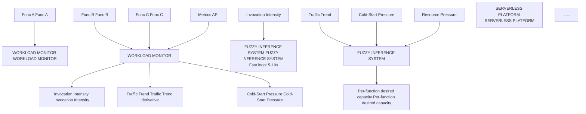
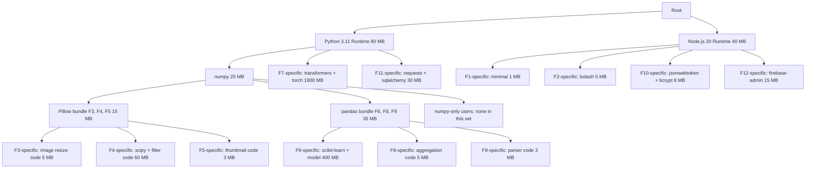

granuwarm_full_paper.md 2026-09-09

# GranuWarm: Adaptive Dependency-Aware Prewarming for Serverless Functions Under Non-Stationary Workloads Using Fuzzy-Controlled Constrained Particle Swarm Optimization

**Authors:** [Your Name], [Co-author/Advisor Name]

**Affiliation:** [Department], [University]

**Corresponding Author:** [Email]

## Abstract

Serverless computing delivers elastic, event-driven execution of cloud functions without explicit infrastructure management, yet suffers from a persistent performance bottleneck: the *cold start*—latency incurred when a container must be provisioned, initialized, and loaded with dependencies before execution begins. Cold-start mitigation is fundamentally a constrained optimization problem: prewarming containers reduces latency but wastes resources on idle capacity, while aggressive reclamation conserves resources but increases user-facing latency and SLA violations. Existing approaches address fragments of this problem—static keep-alive policies, workload-prediction-based provisioning, isolated fuzzy or metaheuristic controllers, and dependency-aware scheduling—but no framework jointly addresses reasoning under workload uncertainty, exploiting inter-function dependency structure for sub-container-level resource sharing, and solving the resulting constrained multi-function allocation problem under hard resource budgets.

This paper presents **GranuWarm**, a closed-loop adaptive prewarming framework that integrates three complementary mechanisms, each with a distinct architectural role. A **Mamdani-type fuzzy inference system** maps real-time workload signals—invocation intensity, traffic trend, cold-start pressure, and resource utilization—to per-function warm-capacity recommendations, enabling uncertainty-aware reasoning without requiring accurate long-horizon workload predictions. A **dependency granularity tree** decomposes the function fleet's software stacks into hierarchical, shareable layers (runtimes, libraries, function-specific code), transforming the decision space from coarse per-function container counts to fine-grained resource units that exploit inter-function overlap. A **constrained Particle Swarm Optimizer** then searches for the globally optimal allocation of warm resources across granularity-tree nodes, minimizing a composite objective of cold-start latency, cold-start frequency, idle-resource cost, and SLA-violation rate, subject to platform memory and capacity constraints. GranuWarm employs a dual-timescale architecture: the fuzzy controller runs on a fast loop (5–10 s) for rapid adaptation, while the PSO optimizer runs on a slower loop (30–60 s) for periodic global re-optimization. We evaluate GranuWarm on a Kubernetes/Knative testbed with 12 heterogeneous benchmark functions under five workload regimes—stable, gradual-growth, bursty, periodic, and non-stationary—and conduct a systematic six-configuration ablation study. Results demonstrate that GranuWarm achieves a superior Pareto frontier on the latency–resource tradeoff, reducing P95 cold-start latency and SLA violations compared to all baselines while maintaining comparable or lower resource consumption, and that each architectural component contributes measurably to overall performance.

1 / 31

2026-09-09

# Keywords: **Serverless Computing** · **Cold-Start Mitigation** · **Fuzzy Inference System** · **Particle Swarm Optimization** · **Dependency-Aware Scheduling** · **Adaptive Resource Management**

# 1. Introduction

## 1.1 The Serverless Computing Paradigm

Cloud computing has undergone a progressive shift from Infrastructure-as-a-Service (IaaS), where users manage virtual machines, through Platform-as-a-Service (PaaS), where the runtime environment is managed, to Function-as-a-Service (FaaS), where the unit of deployment is a single stateless function [1]. In the FaaS model—commercially realized by AWS Lambda, Google Cloud Functions, Azure Functions, and open-source platforms such as Knative [2], OpenFaaS [3], and Apache OpenWhisk [4]—developers deploy event-triggered functions without provisioning or managing servers. The platform handles container lifecycle management, automatic horizontal scaling, and crucially, *scale-to-zero*: when a function receives no invocations for a configurable period, its containers are deallocated entirely, eliminating idle-resource costs.

This elasticity has driven rapid adoption. Datadog's 2024 State of Serverless report indicates that over 70% of organizations using cloud services have adopted serverless technologies in some capacity [5]. However, the scale-to-zero capability introduces a well-documented performance challenge that remains a primary obstacle to serverless adoption for latency-sensitive applications: the **cold start**.

## 1.2 Anatomy of a Cold Start

When a function is invoked and a pre-initialized container is available (a *warm start*), the request is dispatched directly, incurring only network and execution latency—typically single-digit milliseconds. When no warm container exists (a *cold start*), the platform must execute a multi-stage initialization pipeline:

$$T_{cold} = T_{sched} + T_{pull} + T_{runtime} + T_{deps} + T_{init} + T_{exec}$$

where $T_{sched}$ is the scheduling and container-creation overhead, $T_{pull}$ is the container image pull time, $T_{runtime}$ is the language runtime startup (e.g., JVM, Python interpreter, Node.js V8), $T_{deps}$ is the loading and initialization of application-level dependencies (e.g., importing NumPy, loading ML models), $T_{init}$ is function-specific initialization code (e.g., establishing database connections, reading configuration), and $T_{exec}$ is the actual function execution time.

Empirical measurements across major cloud providers reveal that cold-start latencies range from approximately 100 ms for lightweight Node.js functions with minimal dependencies to over 10 seconds for JVM-based functions with large dependency trees or ML model loading [6, 7, 8]. Shahrad et al. [9], analyzing production traces from Azure Functions, found that cold starts affected up to 40% of function invocations during low-traffic periods and contributed disproportionately to tail latency, with P99 latencies exceeding warm-start P99 by 10–50×.

For applications where end-to-end latency is critical—interactive web APIs, real-time data processing pipelines, IoT event handlers, and microservice chains where cold starts compound multiplicatively—this performance penalty can render serverless architectures unsuitable, forcing architects to either over-provision resources (negating the cost benefits of serverless) or accept degraded user experience.

## 1.3 The Latency–Resource Tradeoff

2 / 31

granuwarm_full_paper.md 2026-09-09

Cold-start mitigation is not simply a matter of "keeping containers alive longer." It is fundamentally a **constrained bi-objective optimization** between two competing goals:

**Objective 1 — Minimize cold-start impact:**

$$ \min \quad \alpha_1 \cdot E[T_{cold}] + \alpha_2 \cdot P(cold start) + \alpha_3 \cdot P(SLA violation) $$

**Objective 2 — Minimize resource waste:**

$$ \min \quad \beta_1 \cdot M_{idle} + \beta_2 \cdot C_{idle} $$

where $M_{idle}$ and $C_{idle}$ are idle memory and CPU consumption from pre-warmed but unused containers.

These objectives are in direct tension. Aggressive prewarming (maintaining many warm containers) minimizes cold starts but increases idle-resource costs. Aggressive reclamation (quickly deallocating idle containers) conserves resources but increases cold-start frequency and latency. The optimal operating point is workload-dependent and shifts over time.

This tradeoff is compounded by four characteristics of real serverless workloads that defeat simple heuristics:

1. **Burstiness.** Invocation rates exhibit heavy-tailed distributions with sudden, unpredictable spikes. A function averaging 5 req/s may experience bursts of 500 req/s during flash events [9].

2. **Non-stationarity.** Workload distributions shift continuously—diurnal cycles, weekly patterns, seasonal effects, and regime changes mean that historical statistics become stale [10].

3. **Heterogeneity.** Functions differ vastly in cold-start cost (0.1 s to 10+ s), memory footprint (64 MB to 3+ GB), invocation frequency (sub-second to hours), and latency sensitivity [7].

4. **Resource constraints.** The platform has finite memory, CPU, and budget. Resources allocated to pre-warming one function are unavailable for others.

The central research question is therefore not *"Should we prewarm?"* but:

<mark>Given the current and anticipated workload state, finite platform resources, and per-function SLA requirements, what is the optimal allocation of warm capacity across the function fleet—at what granularity—and how should this allocation adapt over time?</mark>

## 1.4 Limitations of Existing Approaches

The literature on serverless cold-start mitigation has advanced significantly through 2025–2026. We identify five categories of existing work, each addressing a subset of the problem dimensions outlined above:

**Category 1: Static and threshold-based policies.** The simplest approach—and the default in most production platforms—uses fixed keep-alive timers (e.g., AWS Lambda's ~10-minute idle timeout) or static minimum-instance counts [11, 12]. These are non-adaptive: a fixed keep-alive wastes resources during low-traffic periods and provides no protection against bursts exceeding pre-allocated capacity. Provisioned concurrency features (e.g., AWS Provisioned Concurrency) allow users to specify static minimum warm instances but require manual tuning and incur costs regardless of utilization.

**Category 2: Prediction-based prewarming.** Recent work applies time-series forecasting—ARIMA, LSTM networks, spatio-temporal models, and transformers—to predict future invocation rates and proactively

3 / 31

granuwarm_full_paper.md 2026-09-09

prewarm containers [13, 14]. The 2026 WPPSO framework [15] represents the state of the art in this category, combining workload prediction via a spatio-temporal neural network with LLM-based function feature extraction and discrete PSO for container-function matching. WPPSO reports up to 72.2% lower startup latency and 63.4% lower memory footprint versus native Knative. However, prediction-based systems are fundamentally limited by forecast accuracy: prediction errors during regime changes, unprecedented bursts, or novel workload patterns lead to either over-provisioning (wasted resources) or under-provisioning (cold starts)—precisely the scenarios where mitigation matters most.

**Category 3: Dependency-aware scheduling.** Hanaforoosh et al. [16] introduced a granularity-tree-based scheduler that exploits package dependency structure for serverless cold-start reduction, evaluated on Kubernetes + Fission. Their key insight is that functions sharing runtime layers and libraries need not be treated as monolithic deployment units; instead, shared dependencies can be maintained at finer granularity. This structural insight is valuable but does not incorporate an explicit adaptive control mechanism for dynamically adjusting prewarming levels under changing workload and resource conditions—the scheduler decides *what* to share but not *how much* to prewarm under uncertainty.

**Category 4: Fuzzy-control-based approaches.** Fuzzy logic has been applied to serverless resource management in two notable instances: a 2025 Chinese patent application [17] describing fuzzy-controlled container preheating with inputs including invocation count, execution time, and memory, and the 2026 WarmFlex system [18], which uses a fuzzy controller to adapt keep-alive duration based on inter-arrival time feedback. These demonstrate that fuzzy inference naturally handles the imprecise, gradual nature of workload characterization ("traffic is moderately high," "memory pressure is increasing"). However, both operate at the individual-function level—each function's prewarming decision is made independently—and neither addresses the constrained multi-function allocation problem where prewarming one function consumes resources needed by another.

**Category 5: Metaheuristic optimization.** PSO, genetic algorithms, and ant colony optimization have been applied to cloud resource scheduling and container placement [15, 19, 20]. These approaches can find good solutions to combinatorial allocation problems but typically operate as standalone optimizers without integrated uncertainty-aware reasoning or dependency-structure-aware search spaces. Without a meaningful objective signal derived from workload state, they optimize blind.

**The gap.** Table 1 summarizes the coverage of existing approaches across five critical problem dimensions.

**Table 1.** Coverage of existing approaches across problem dimensions.

| Approach | Workload Uncertainty | Multi-Function Constraint | Dependency Awareness | Adaptive Control | Online Optimization |
| --- | --- | --- | --- | --- | --- |
| Static policies [11, 12] | X | X | X | X | X |
| Prediction-based [13, 14, 15] | Partial | ✓ | X | X | ✓ |
| Granularity-tree [16] | X | X | ✓ | X | X |

4 / 31

2026-09-09

| Approach | Workload Uncertainty | Multi-Function Constraint | Dependency Awareness | Adaptive Control | Online Optimization |
| --- | --- | --- | --- | --- | --- |
| Fuzzy control [17, 18] | ✓ | X | X | ✓ | X |
| PSO-based [15, 19] | X | ✓ | X | X | ✓ |
| GranuWarm (ours) | ✓ | ✓ | ✓ | ✓ | ✓ |

No existing framework simultaneously addresses all five dimensions. This is the gap GranuWarm fills.

## 1.5 Proposed Approach: GranuWarm

We propose **GranuWarm** (Granularity-aware Warm-capacity controller), a closed-loop adaptive prewarming framework that assigns each technique a distinct, architecturally motivated role:

- **Fuzzy Inference System** → Reasons under workload uncertainty to produce per-function warm-capacity *recommendations*.
- **Dependency Granularity Tree** → Transforms the per-function decision space into a finer-grained, dependency-aware resource-unit space that exploits inter-function sharing.
- **Constrained PSO** → Searches for the globally optimal allocation of warm resources across granularity-tree nodes under hard resource constraints.
- **Feedback loop** → Observed post-decision metrics (latencies, cold-start rates, resource utilization) feed back to close the control loop.

Critically, GranuWarm employs a **dual-timescale architecture**: the computationally lightweight fuzzy controller executes on a fast loop (every 5–10 s) for rapid reactive adaptation, while the heavier PSO optimizer executes on a slower loop (every 30–60 s) for periodic global re-optimization. This separation prevents optimizer overhead from becoming a bottleneck while maintaining fast responsiveness to workload shifts.

## 1.6 Contributions

The principal contributions of this work are:

1. **A novel problem formulation** that frames serverless prewarming as constrained optimization over a dependency-granularity search space, moving beyond per-function container counts to shared-layer resource allocation.

2. **A unified closed-loop architecture** integrating workload-uncertainty-aware fuzzy control, dependency-structure-aware granularity decomposition, and constrained multi-objective PSO into a single adaptive framework, with each component addressing a distinct problem dimension.

3. **A dual-timescale control design** separating fast, lightweight fuzzy adaptation from periodic global PSO optimization, balancing responsiveness against computational overhead.

4. **A comprehensive experimental evaluation** with a systematic six-configuration ablation study across five workload regimes, demonstrating that each architectural component contributes measurably and

5 / 31

granuwarm_full_paper.md 2026-09-09

that the full system achieves a superior Pareto frontier on the latency–resource tradeoff.

# 1.7 Research Questions

This work is guided by three experimentally testable research questions:

- **RQ1:** Does workload-aware fuzzy control reduce cold-start frequency and latency compared to fixed and static prewarming strategies?

- **RQ2:** Does constrained PSO optimization of the fuzzy controller's recommended allocation improve the latency–resource tradeoff beyond what either technique achieves independently?

- **RQ3:** Does incorporating dependency-granularity structure into the decision space improve resource efficiency compared to function-level prewarming?

# 1.8 Paper Organization

Section 2 reviews related work. Section 3 formalizes the problem. Section 4 presents the GranuWarm architecture. Section 5 describes the experimental methodology. Section 6 presents results and discussion. Section 7 addresses limitations and threats to validity. Section 8 concludes the paper.

# 2. Related Work

This section surveys the five streams of prior work most relevant to GranuWarm: serverless cold-start characterization, prewarming and keep-alive strategies, dependency-aware scheduling, fuzzy control in cloud systems, and metaheuristic optimization for resource management.

## 2.1 Cold-Start Characterization

Understanding the sources and magnitude of cold-start latency is foundational. Mohan et al. [6] provided one of the earliest systematic measurements of cold-start latency across AWS Lambda, Google Cloud Functions, and Azure Functions, finding that runtime choice (interpreted vs. compiled), deployment package size, and allocated memory significantly impact initialization time. Wang et al. [7] extended this analysis with a deeper investigation of AWS Lambda's container lifecycle, documenting the internal stages of cold-start initialization and identifying that dependency loading—not container provisioning—dominates cold-start time for functions with large packages.

Shahrad et al. [9] presented the most comprehensive analysis to date, analyzing production traces from Azure Functions comprising millions of function invocations. Key findings include: (i) function popularity follows a heavy-tailed Zipf distribution—a small fraction of functions account for the majority of invocations; (ii) inter-arrival times vary by orders of magnitude across functions; (iii) cold starts disproportionately affect infrequently invoked functions; and (iv) a fixed 10-minute keep-alive policy results in substantial resource waste for popular functions while providing inadequate protection for bursty ones.

Bermbach et al. [8] and Maissen et al. [21] developed benchmarking frameworks (FaaSdom) for systematic cross-provider cold-start measurement, enabling reproducible comparison. These studies collectively establish that cold-start mitigation is not a one-size-fits-all problem—different functions exhibit different cold-start profiles, invocation patterns, and sensitivity to latency.

## 2.2 Prewarming and Keep-Alive Strategies

6 / 31

granuwarm_full_paper.md 2026-09-09

The simplest mitigation is extending keep-alive duration. Akkus et al. [11] proposed SAND, which uses application-level sandboxing to share runtimes across functions within an application, reducing per-function cold-start cost. Oakes et al. [22] introduced SOCK, which optimizes container initialization through lean containers and import caching.

Prediction-based prewarming has received increasing attention. Shahrad et al. [14] proposed a hybrid histogram-based policy that adapts keep-alive durations based on observed inter-arrival time distributions. Suresh and Gandhi [13] developed ServerMore, which uses invocation history to predict upcoming requests and opportunistically pre-warm containers. Lin and Khazaei [23] applied LSTM-based time-series forecasting to predict function invocation volumes and pre-provision containers accordingly.

The 2026 WPPSO framework [15] represents the current state of the art, combining: (i) LLM-based extraction of function features (resource requirements, dependency characteristics), (ii) a spatio-temporal neural network for workload prediction, (iii) greedy initialization for container placement, (iv) discrete PSO for container-function matching, and (v) hierarchical container recycling. Evaluated on Knative, WPPSO reports 72.2% lower startup latency and 63.4% lower memory footprint versus native Knative autoscaling. However, WPPSO's reliance on accurate workload prediction makes it vulnerable to forecast errors during regime changes and unprecedented bursts.

## 2.3 Dependency-Aware and Fine-Grained Scheduling

Rather than treating each function deployment as monolithic, several approaches exploit dependency structure for optimization. Hanaforoosh et al. [16] proposed a granularity-tree-based scheduler where functions' dependency stacks are represented as hierarchical trees, enabling the platform to maintain shared dependency layers across functions. Their evaluation on Kubernetes + Fission demonstrated reduced cold-start latency through dependency reuse. Critically, their scheduler makes deployment-time decisions about dependency sharing but does not dynamically adjust prewarming levels at runtime.

Du et al. [24] explored checkpoint/restore mechanisms (CRIU) to snapshot initialized containers and rapidly restore them, effectively amortizing cold-start cost across invocations. Cadden et al. [25] proposed unikernels as lightweight alternatives to containers, eliminating OS-level overhead. These approaches are complementary to—rather than competing with—GranuWarm's control-layer optimization.

## 2.4 Fuzzy Control in Cloud Resource Management

Fuzzy logic has a long history in control systems [26] and has been applied to cloud computing for VM provisioning, load balancing, and autoscaling. Jamshidi et al. [27] demonstrated fuzzy autoscaling for multi-tier web applications, showing that fuzzy controllers can adapt to workload changes without precise mathematical models of the system being controlled.

In the serverless domain specifically, a 2025 Chinese patent application [17] describes a fuzzy-control-based container preheating method with inputs including historical invocation count, average execution time, and memory usage, producing a preheated-container count as output. The 2026 WarmFlex system [18] uses a Mamdani fuzzy controller to adapt keep-alive duration based on inter-arrival time feedback, demonstrating that fuzzy logic can effectively navigate the keep-alive tradeoff. Both systems, however, operate per-function independently—they cannot reason about multi-function resource competition or exploit dependency sharing.

## 2.5 Metaheuristic Optimization for Cloud Scheduling

7 / 31

granuwarm_full_paper.md 2026-09-09

PSO [28] and its variants have been extensively applied to cloud task scheduling, VM placement, and container orchestration [19, 20]. Typical formulations encode resource allocations as particle positions and optimize makespan, cost, or energy consumption. Discrete and constrained PSO variants handle integer decision variables and resource budgets through penalty functions or repair operators.

In the serverless context, WPPSO [15] uses discrete PSO for container-function matching after workload prediction. However, its PSO operates over a per-function container assignment space, not a dependency-granularity-aware space, and is tightly coupled with the prediction model rather than an adaptive control layer.

## 2.6 Positioning of GranuWarm

GranuWarm differs from all prior work in three respects:

1. **Problem formulation.** We formulate prewarming as constrained optimization over dependency-granularity-tree nodes—a richer search space than per-function containers—under a multi-objective fitness function incorporating latency, cold-start rate, resource cost, and SLA violations.

2. **Architectural integration.** Rather than using fuzzy control alone (WarmFlex), PSO alone (WPPSO), or granularity analysis alone (Hanaforoosh), GranuWarm assigns each a distinct, non-redundant role: fuzzy control for uncertainty-aware recommendation, granularity tree for search-space transformation, and constrained PSO for global optimization.

3. **Closed-loop adaptive control.** GranuWarm continuously observes system state and adapts, unlike static scheduling or one-shot optimization approaches.

---

## 3. Problem Formulation

This section formalizes the serverless prewarming problem that GranuWarm addresses.

### 3.1 System Model

Consider a serverless platform hosting a set $F = \{f_1, f_2, \ldots, f_N\}$ of $N$ functions. Each function $f_i$ is characterized by:

- $m_i$: memory required per container instance (MB)
- $\tau_i^{cold}$: expected cold-start latency (ms)
- $\tau_i^{warm}$: expected warm-start latency (ms)
- $\lambda_i(t)$: invocation rate at time $t$ (req/s)
- $\delta_i$: SLA latency threshold (ms)

The platform has total available memory $M_{budget}$ for pre-warmed containers.

### 3.2 Dependency Granularity Model

Each function $f_i$ has a dependency stack $D_i = \{d_{i,1}, d_{i,2}, \ldots, d_{i, |D_i|}\}$, where each dependency $d_{i,j}$ has memory footprint $m_{d_{i,j}}$ and initialization time $\tau_{d_{i,j}}$.

The **granularity tree** $G = (V, E)$ is constructed by merging identical dependencies across functions into shared nodes. The node set $V = \{v_1, v_2, \ldots, v_K\}$ represents distinct dependency layers, where $K \leq$

8 / 31

granuwarm_full_paper.md 2026-09-09

$$\sum_{i} |D_i|$$ (equality holds when no dependencies are shared). Each leaf node corresponds to a function-specific component; internal nodes represent shared layers.

Let $V(f_i) \subseteq V$ denote the set of granularity-tree nodes in the dependency path of function $f_i$.

## 3.3 Prewarming Allocation

**A prewarming allocation** is a vector $x = [x_1, x_2, \dots, x_K] \in Z^K_{\ge 0}$, where $x_k$ is the number of warm instances of granularity-tree node $v_k$.

Function $f_i$ is *fully warm* if all nodes in its dependency path have at least one warm instance:

$$w_i(x) = \min_{v_k \in V(f_i)} x_k$$

represents the effective number of warm containers available for function $f_i$.

## 3.4 Performance Metrics

Given allocation $x$ and current workload state, we define:

**Cold-start rate** for function $f_i$:

$$C_i(x) = \max \left( 0, 1 - \frac{w_i(x)}{\lceil \lambda_i \cdot T_{window} \rceil} \right)$$

where $T_{window}$ is the observation window duration.

**Expected latency** for function $f_i$:

$$L_i(x) = C_i(x) \cdot \tau_i^{cold} + (1 - C_i(x)) \cdot \tau_i^{warm}$$

**Idle memory cost:**

$$M_{idle}(x) = \sum_{k=1}^{K} m_{v_k} \cdot \max(0, x_k - u_k)$$

where $u_k$ is the current utilization of node $v_k$.

**SLA violation rate** for function $f_i$:

$$S_i(x) = P(L_i > \delta_i)$$

## 3.5 Optimization Problem

The prewarming problem is:

$$\min_{x} \quad J(x) = w_L \sum_{i=1}^{N} L_i(x) + w_C \sum_{i=1}^{N} C_i(x) + w_M \cdot M_{idle}(x) + w_S \sum_{i=1}^{N} S_i(x)$$

subject to:

9 / 31

granuwarm_full_paper.md 2026-09-09

$$\sum_{k=1}^{K} m_{v_k} \cdot x_k \leq M_{budget} \quad (memory constraint)$$

$$x_k^{\min} \leq x_k \leq x_k^{\max} \quad \forall k \in \{1, \dots, K\} \quad (capacity bounds)$$

$$x_k \in Z_{\geq 0} \quad \forall k \quad (integrality)$$

*where $w_L, w_C, w_M, w_S$ are objective weights satisfying $w_L + w_C + w_M + w_S = 1$.*

This problem is NP-hard in general (it reduces to a variant of the multi-dimensional knapsack problem), motivating the use of metaheuristic optimization.

## 3.6 Dynamic Nature

The problem is not solved once. The workload $\lambda_i(t)$ is non-stationary, meaning the optimal allocation **x**$^*(t)$ changes over time. GranuWarm addresses this through continuous closed-loop control rather than one-shot optimization.

## 4. Proposed Framework: GranuWarm

### 4.1 System Architecture Overview

GranuWarm is structured as a six-component closed-loop control system:



10 / 31

granuwarm_full_paper.md 2026-09-09

# Flowchart Data

| Step | Description |
| --- | --- |
| 1 | DEPENDENCY GRANULARITY TREE |
| 2 | Per-node desired capacity |
| 3 | CONSTRAINED PSO (Slow loop: 30-60s) |
| 4 | Optimal allocation |
| 5 | CONTAINER MANAGER (Knative API) |
| 6 | PREWARM |
| 7 | RECLAIM |
| 8 | OBSERVED METRICS → FEEDBACK |

## 4.2 Component 1: Workload Monitor

The workload monitor continuously collects and processes four real-time signals from the platform's metrics API (Prometheus in our Knative deployment).

**Signal 1 — Invocation Intensity** $R_i(t)$:

The current request rate for function $f_i$, computed as the number of invocations in the last $\Delta t$ seconds divided by $\Delta t$:

$$R_i(t) = \frac{N_i^{invocations}(t - \Delta t, t)}{\Delta t}$$

We use $\Delta t = 10$ s to balance responsiveness against noise.

**Signal 2 — Traffic Trend** $T_i(t)$:

The rate of change in invocation intensity, providing predictive signal about workload direction:

$$T_i(t) = R_i(t) - R_i(t - \Delta t)$$

Positive values indicate increasing traffic; negative values indicate decreasing traffic. The magnitude indicates the rate of change.

11 / 31

granuwarm_full_paper.md 2026-09-09

# **Signal 3 — Cold-Start Pressure $C_i(t)$:**

The fraction of recent invocations that experienced cold starts:

$$C_i(t) = \frac{N_i^{cold}(t - W, t)}{N_i^{total}(t - W, t)}$$

where **$W$** is a sliding window (we use **$W = 60$** s). This signal directly measures the severity of the cold-start problem for each function.

# **Signal 4 — Resource Pressure $M(t)$:**

Platform-level memory utilization:

$$M(t) = \frac{M_{used}(t)}{M_{available}}$$

This is a global signal (not per-function) that prevents the controller from recommending prewarming that would exhaust platform resources.

## 4.3 Component 2: Fuzzy Inference System

We design a Mamdani-type fuzzy inference system [26] that maps the four workload signals to a desired warm-capacity level for each function.

### 4.3.1 Fuzzification — Input Membership Functions

Each input variable is partitioned into linguistic terms with overlapping triangular/trapezoidal membership functions:

**Invocation Intensity ($R$), normalized to $[0, 1]$ relative to the function's historical maximum:**

| Term | Type | Parameters |
| --- | --- | --- |
| LOW | Trapezoidal | (0, 0, 0.15, 0.35) |
| MEDIUM | Triangular | (0.2, 0.5, 0.8) |
| HIGH | Trapezoidal | (0.65, 0.85, 1.0, 1.0) |

**Traffic Trend ($T$), normalized to $[-1, 1]$:**

| Term | Type | Parameters |
| --- | --- | --- |
| FALLING | Trapezoidal | (-1, -1, -0.5, -0.1) |
| STABLE | Triangular | (-0.2, 0, 0.2) |
| RISING | Triangular | (0.1, 0.4, 0.7) |
| SURGING | Trapezoidal | (0.5, 0.8, 1, 1) |

**Cold-Start Pressure ($C$), range $[0, 1]$:**

12 / 31

granuwarm_full_paper.md
2026-09-09

| Term | Type | Parameters |
| --- | --- | --- |
| LOW | Trapezoidal | (0, 0, 0.1, 0.3) |
| MEDIUM | Triangular | (0.15, 0.4, 0.65) |
| HIGH | Trapezoidal | (0.5, 0.7, 1, 1) |

**Resource Pressure** ($M$), range [0, 1]:

| Term | Type | Parameters |
| --- | --- | --- |
| LOW | Trapezoidal | (0, 0, 0.3, 0.5) |
| MEDIUM | Triangular | (0.35, 0.55, 0.75) |
| HIGH | Trapezoidal | (0.65, 0.8, 1, 1) |

## 4.3.2 Output Membership Functions

**Desired Warm Capacity** ($P$), normalized to [0, 1]:

| Term | Type | Parameters |
| --- | --- | --- |
| VERY_LOW | Trapezoidal | (0, 0, 0.05, 0.2) |
| LOW | Triangular | (0.1, 0.25, 0.4) |
| MEDIUM | Triangular | (0.3, 0.5, 0.7) |
| HIGH | Triangular | (0.6, 0.75, 0.9) |
| VERY_HIGH | Trapezoidal | (0.8, 0.95, 1, 1) |

The defuzzified output is then scaled to the function's capacity range $[x_i^{\min}, x_i^{\max}]$:

$$P_i^{desired} = x_i^{\min} + P_i^{fuzzy} \cdot (x_i^{\max} - x_i^{\min})$$

## 4.3.3 Rule Base

The rule base consists of 27 rules (a subset of the full $3 \times 4 \times 3 \times 3 = 108$ possible combinations, pruned to the most operationally relevant). We present representative rules organized by priority:

**Table 2.** Representative fuzzy rules (27 of 27 shown).

| # | Invocation (R) | Trend (T) | Cold-Start (C) | Memory (M) | → Warm Capacity (P) |
| --- | --- | --- | --- | --- | --- |
| 1 | LOW | FALLING | LOW | — | VERY_LOW |
| 2 | LOW | STABLE | LOW | — | VERY_LOW |
| 3 | LOW | STABLE | MEDIUM | LOW | LOW |
| 4 | LOW | STABLE | MEDIUM | MEDIUM | VERY_LOW |
| 5 | LOW | RISING | LOW | LOW | LOW |

13 / 31

2026-09-09

| # | Invocation (R) | Trend (T) | Cold-Start (C) | Memory (M) | → Warm Capacity (P) |
| --- | --- | --- | --- | --- | --- |
| 6 | LOW | RIISING | MEDIUM | LOW | MEDIUM |
| 7 | LOW | RIISING | HIGH | LOW | MEDIUM |
| 8 | LOW | SURGING | — | LOW | MEDIUM |
| 9 | LOW | SURGING | — | HIGH | LOW |
| 10 | MEDIUM | FALLING | LOW | — | LOW |
| 11 | MEDIUM | STABLE | LOW | LOW | MEDIUM |
| 12 | MEDIUM | STABLE | LOW | HIGH | LOW |
| 13 | MEDIUM | STABLE | MEDIUM | LOW | MEDIUM |
| 14 | MEDIUM | STABLE | HIGH | LOW | HIGH |
| 15 | MEDIUM | RIISING | LOW | LOW | MEDIUM |
| 16 | MEDIUM | RIISING | MEDIUM | LOW | HIGH |
| 17 | MEDIUM | RIISING | HIGH | LOW | HIGH |
| 18 | MEDIUM | SURGING | — | LOW | HIGH |
| 19 | MEDIUM | SURGING | — | HIGH | MEDIUM |
| 20 | HIGH | FALLING | LOW | — | MEDIUM |
| 21 | HIGH | STABLE | LOW | LOW | HIGH |
| 22 | HIGH | STABLE | MEDIUM | LOW | HIGH |
| 23 | HIGH | STABLE | HIGH | LOW | VERY_HIGH |
| 24 | HIGH | RIISING | — | LOW | VERY_HIGH |
| 25 | HIGH | RIISING | — | HIGH | HIGH |
| 26 | HIGH | SURGING | — | LOW | VERY_HIGH |
| 27 | HIGH | SURGING | — | HIGH | HIGH |

Rules use "—" to indicate don't-care conditions (the rule fires regardless of that input's value).

**Rule evaluation** uses minimum (AND) for antecedent conjunction, maximum for rule aggregation, and centroid for defuzzification (standard Mamdani procedure).

## 4.3.4 Design Rationale

The rule base encodes four domain principles:

1. **Load-proportional scaling**: Higher invocation rates warrant more warm capacity (Rules 1–2 vs. 21–26).
2. **Trend-anticipatory response**: Rising/surging trends trigger proactive scaling before cold starts occur (Rules 5–8, 15–18, 24–26).

14 / 31

granuwarm_full_paper.md 2026-09-09

**3. Cold-start feedback:** High cold-start pressure increases warm capacity even when invocation rate is moderate (Rules 14, 17, 23).

**4. Resource-constrained moderation:** High memory pressure dampens warm-capacity recommendations to prevent platform overload (Rules 9, 12, 19, 25, 27).

## 4.4 Component 3: Dependency Granularity Tree

### 4.4.1 Construction

The granularity tree is constructed offline (or periodically updated when the function fleet changes) using the following procedure:

**Algorithm 1: Granularity Tree Construction**

```
Input:  Function set F = {f<sub>1</sub>, ..., f<sub>n</sub>}
        Dependency manifests D(f<sub>i</sub>) for each function
Output: Granularity tree G = (V, E)

1.  V ← ∅, E ← ∅
2.  for each function f<sub>i</sub> ∈ F do
3.      Extract dependency list D(f<sub>i</sub>) = {(pkg, version), ...}
4.      Identify runtime layer r<sub>i</sub> (e.g., Python 3.11, Node.js 20)
5.  end for
6.  
7.  // Layer 0: Shared runtimes
8.  for each unique runtime r do
9.      Create node v<sub>r</sub> with memory m<sub>r</sub> and init time τ<sub>r</sub>
10.     V ← V U {v<sub>r</sub>}
11.  end for
12.  
13. // Layer 1: Shared library bundles
14. Compute pairwise dependency overlap: O(f<sub>i</sub>, f<sub>j</sub>) = D(f<sub>i</sub>) ∩ D(f<sub>j</sub>)
15. Apply agglomerative clustering on dependency sets using Jaccard similarity
16. for each cluster of shared dependencies S do
17.     Create node v<sub>S</sub> with memory Σ<sub>d∈S</sub> m<sub>d</sub>
18.     V ← V U {v<sub>S</sub>}
19.     E ← E U {(v<sub>r</sub>, v<sub>S</sub>)} where r is the common runtime
20. end for
21.  
22. // Layer 2: Function-specific components
23. for each function f<sub>i</sub> do
24.     Compute unique deps: U(f<sub>i</sub>) = D(f<sub>i</sub>) \ U<sub>{S}</sub> S
25.     Create leaf node v<sub>f<sub>i</sub></sub> with memory Σ<sub>d∈U(f<sub>i</sub>)</sub> m<sub>d</sub> + m<sub>code(f<sub>i</sub>)</sub>
26.     V ← V U {v<sub>f<sub>i</sub></sub>}
27.     E ← E U {(v<sub>parent</sub>, v<sub>f<sub>i</sub></sub>)} where v<sub>parent</sub> is f<sub>i</sub>'s shared-layer node
28. end for
29.  
30. return G = (V, E)
```

## 4.4.2 Projection of Fuzzy Recommendations

15 / 31

granuwarm_full_paper.md 2026-09-09

The fuzzy controller produces per-function recommendations $\{P_1, P_2, \ldots, P_N\}$. These are projected onto granularity-tree nodes as follows:

For each granularity-tree node $v_k$, let $F(v_k)$ denote the set of functions that depend on $v_k$. The projected recommendation for $v_k$ is:

$$P_k^{tree} = max_{f_i \in F(v_k)} P_i$$

This ensures that a shared layer is kept warm at the level required by the most demanding function that uses it.

## 4.4.3 Example

Consider four functions with the following dependency structure:

| Item | Memory (MB) | Time (ms) |
| --- | --- | --- |
| Python 3.11 Runtime | 80 | 200 |
| numpy + scipy | 120 | 150 |
| Function A: Pillow, image utils | 100 | 80 |
| Function B: scikit-learn, model | 500 | 400 |
| requests + flask | 40 | 50 |
| Function C: DB driver, ORM | 60 | 100 |
| Function D: Firebase SDK | 40 | 60 |

The granularity tree has $K = 7$ nodes. Keeping the Python runtime warm benefits all four functions. Keeping numpy warm benefits Functions A and B. This structural sharing is invisible to per-function optimization approaches.

## 4.5 Component 4: Constrained PSO Optimizer

### 4.5.1 Particle Representation

Each particle in the swarm represents a candidate prewarming allocation:

$$x^{(p)} = [x_1^{(p)}, x_2^{(p)}, \ldots, x_K^{(p)}] \in Z_{\ge 0}^K$$

where $x_k^{(p)}$ is the number of warm instances of granularity-tree node $v_k$ proposed by particle $p$.

### 4.5.2 Fitness Function

Each particle's fitness is evaluated using the composite objective from Section 3.5:

$$J(x) = w_L \cdot \bar{L}(x) + w_C \cdot \bar{C}(x) + w_M \cdot \hat{M}(x) + w_S \cdot \bar{S}(x)$$

where $\bar{L}, \bar{C}, \hat{M}, \bar{S}$ are the normalized (to $[0, 1]$) average latency, cold-start rate, idle memory, and SLA violation rate respectively.

Default weights: $w_L = 0.35, w_C = 0.25, w_M = 0.25, w_S = 0.15$.

## 4.5.3 Constraint Handling

16 / 31

granuwarm_full_paper.md 2026-09-09

We handle the memory constraint using a penalty function approach:

$$J_{penalized}(x) = J(x) + \rho \cdot \max \left( 0, \sum_{k=1}^{K} m_{v_k} x_k - M_{budget} \right)^2$$

where $\rho$ is a penalty coefficient. Capacity bounds $x_k^{\min} \leq x_k \leq x_k^{\max}$ are enforced by clamping after each velocity update.

## 4.5.4 Velocity and Position Update

Standard PSO with inertia weight:

$$v_k^{(p)}(t + 1) = \omega \cdot v_k^{(p)}(t) + c_1 r_1 \left( pbest_k^{(p)} - x_k^{(p)}(t) \right) + c_2 r_2 \left( gbest_k - x_k^{(p)}(t) \right)$$

$$x_k^{(p)}(t + 1) = round \left( x_k^{(p)}(t) + v_k^{(p)}(t + 1) \right)$$

followed by clamping:

$$x_k^{(p)}(t + 1) = clamp \left( x_k^{(p)}(t + 1), x_k^{\min}, x_k^{\max} \right)$$

## **PSO Parameters:**

| Parameter | Symbol | Value |
| --- | --- | --- |
| Swarm size | $S$ | 30 |
| Iterations per optimization cycle | $I_{\max}$ | 50 |
| Inertia weight | $\omega$ | 0.7 → 0.4 (linearly decreasing) |
| Cognitive coefficient | $c_1$ | 1.5 |
| Social coefficient | $c_2$ | 1.5 |
| Penalty coefficient | $\rho$ | 100 |

## 4.5.5 Initialization

Rather than random initialization, particles are seeded intelligently:

- **Particle 1**: The fuzzy controller's projected recommendations $P_k^{tree}$ (the "desired" allocation).
- **Particle 2**: The current active allocation (continuity prior).
- **Particles 3–5**: Scaled versions of the fuzzy recommendation (0.5×, 0.75×, 1.25×).
- **Particles 6–30**: Random perturbations around the fuzzy recommendation.

This ensures the swarm starts near promising regions, improving convergence speed within the limited iteration budget.

## 4.6 Component 5: Container Manager

The container manager translates the PSO-determined allocation into platform actions via the Knative Serving API:

17 / 31

granuwarm_full_paper.md 2026-09-09

- **Prewarming:** For each granularity-tree node $v_k$ where $x_k^* > x_k^{current}$, issue scale-up commands to create $(x_k^* - x_k^{current})$ new warm instances.
- **Reclamation:** For $x_k^* < x_k^{current}$, mark $(x_k^{current} - x_k^*)$ idle instances for reclamation.

To avoid oscillation, we apply a **hysteresis band**: reclamation is only triggered when the current allocation exceeds the optimal by more than a threshold $\epsilon_{reclaim}$ (default: 2 instances).

## 4.7 Component 6: Feedback Loop

After each control cycle, the workload monitor collects updated metrics:

- Actual cold-start count and rate per function
- P50, P95, P99 latency per function
- Memory utilization
- SLA violation count

These metrics serve two purposes:

1. **Input to the next fuzzy inference cycle** (cold-start pressure and resource pressure signals).
2. **Fitness evaluation for the PSO** (actual latency and cold-start data replace estimates).

## 4.8 Dual-Timescale Control Loop

**Algorithm 2: GranuWarm Control Loop**

| Input | Function set F, Granularity tree G, Memory budget M_budget Fast loop interval $\Delta t_{fast} = 10s$ Slow loop interval $\Delta t_{slow} = 60s$ |
| --- | --- |
| Output | Continuous prewarming allocation decisions |
| Steps | 1. Initialize allocation $x \leftarrow$ uniform allocation within budget 2. $t_{last\_pso} \leftarrow current\_time()$ 3. 4. LOOP FOREVER: 5. // — FAST LOOP (every $\Delta t_{fast}$) — 6. metrics $\leftarrow$ WorkloadMonitor.collect() 7. 8. for each function $f_i \in F$ do 9. $R_i \leftarrow metrics.invocation\_rate(f_i)$ 10. $T_i \leftarrow metrics.trend(f_i)$ 11. $C_i \leftarrow metrics.cold\_start\_pressure(f_i)$ 12. $M \leftarrow metrics.resource\_pressure()$ 13. 14. $P_i \leftarrow FuzzyController.infer(R_i, T_i, C_i, M)$ 15. end for 16. 17. $P_{tree} \leftarrow GranularityTree.project(\{P_1, \dots, P_n\})$ 18. 19. // — SLOW LOOP (every $\Delta t_{slow}$) — 20. if $current\_time() - t_{last\_pso} \ge \Delta t_{slow}$ then 21. $x^* \leftarrow PSO.optimize(P_{tree}, G, M_{budget}, metrics)$ 22. $x \leftarrow x^*$ |

18 / 31

2026-09-09

```
23.     t_last_pso <- current_time()
24.     else
25.       // Between PSO cycles: apply fuzzy recommendations directly
26.       // with budget scaling if necessary
27.       x <- BudgetScale(P_tree, M_budget)
28.     end if
29.
30.     ContainerManager.apply(x)
31.
32.     WAIT(Δt_fast)
33. END LOOP
```

The <mark>BudgetScale</mark> function (line 27) provides a fast, approximate allocation when the PSO is not running: it proportionally scales the fuzzy recommendations to fit within the memory budget.

## 4.9 Computational Complexity

| Component | Time Complexity per Cycle | Typical Execution Time |
| --- | --- | --- |
| Workload Monitor | O(N) | < 1 ms |
| Fuzzy Inference (per function) | O(R) where R = number of rules | < 1 ms |
| Granularity Tree Projection | O(K) | < 1 ms |
| PSO (per slow cycle) | O(S \cdot I_{\max} \cdot K) | 50–500 ms |
| Total fast loop | O(N \cdot R + K) | ~5 ms |
| Total slow loop | O(N \cdot R + S \cdot I_{\max} \cdot K) | ~200 ms |

The fast loop is computationally negligible. The PSO slow loop, executing every 30–60 s with 30 particles × 50 iterations × ~10 dimensions, completes well within the inter-cycle interval.

## 5. Experimental Methodology

### 5.1 Testbed

All experiments are conducted on a Kubernetes cluster with the following configuration:

**Table 3.** Testbed hardware and software configuration.

| Component | Specification |
| --- | --- |
| Cluster nodes | 4 worker nodes, 1 control-plane node |
| Node hardware | [Specify: e.g., 8 vCPU, 32 GB RAM per node] |
| Kubernetes version | v1.28 |
| Serverless platform | Knative Serving v1.13 |
| Container runtime | containerd v1.7 |

19 / 31

granuwarm_full_paper.md 2026-09-09

| Component | Specification |
| --- | --- |
| Metrics collection | Prometheus + custom exporter |
| Networking | Istio service mesh |
| GranuWarm controller | Python 3.11, scikit-fuzzy, custom PSO |

5.2 Benchmark Functions

We deploy 12 heterogeneous serverless functions spanning four categories:

**Table 4.** Benchmark function characteristics.

| ID | Function | Runtime | Dependencies | Container Memory | Cold-Start Time | Category |
| --- | --- | --- | --- | --- | --- | --- |
| F1 | helloWorld | Node.js 20 | Minimal | 128 MB | ~150 ms | Lightweight |
| F2 | jsonTransform | Node.js 20 | lodash | 128 MB | ~200 ms | Lightweight |
| F3 | imageResize | Python 3.11 | Pillow, numpy | 512 MB | ~1.2 s | Image |
| F4 | imageFilter | Python 3.11 | Pillow, numpy, scipy | 512 MB | ~1.4 s | Image |
| F5 | thumbnailGen | Python 3.11 | Pillow | 256 MB | ~0.9 s | Image |
| F6 | mlInference | Python 3.11 | scikit-learn, numpy, pandas | 1024 MB | ~3.5 s | ML |
| F7 | sentimentAnalysis | Python 3.11 | transformers, torch | 2048 MB | ~8.0 s | ML |
| F8 | dataAggregate | Python 3.11 | pandas, numpy | 512 MB | ~1.5 s | Data |
| F9 | csvParser | Python 3.11 | pandas | 256 MB | ~1.0 s | Data |
| F10 | authService | Node.js 20 | jsonwebtoken, bcrypt | 256 MB | ~300 ms | API |
| F11 | orderProcess | Python 3.11 | requests, sqlalchemy | 256 MB | ~0.8 s | API |
| F12 | notification | Node.js 20 | firebase-admin | 256 MB | ~350 ms | API |

20 / 31

granuwarm_full_paper.md 2026-09-09

These functions are chosen to create significant dependency overlap: F3, F4, F5 share Pillow; F3, F4, F6, F8, F9 share numpy; F6, F8, F9 share pandas; F3–F9 share the Python 3.11 runtime; F1, F2, F10, F12 share the Node.js 20 runtime.

## 5.3 Dependency Granularity Tree for Benchmark Functions

The constructed granularity tree for the 12 benchmark functions:



Total granularity-tree nodes: $K = 20$.

## 5.4 Workload Generation

We evaluate under five canonical workload regimes, each running for 30 minutes:

**Table 5. Workload regime characteristics.**

| Regime | Description | Invocation Pattern |
| --- | --- | --- |
| W1: Stable | Constant-rate Poisson arrivals | $\lambda_i(t) = \bar{\lambda}_i \quad \forall t$ |
| W2: Gradual Growth | Linearly increasing rate | $\lambda_i(t) = \bar{\lambda}_i \cdot (1 + 0.05t)$ |
| W3: Bursty | Periodic traffic spikes (10× baseline) | $\lambda_i(t) = \bar{\lambda}_i + 9\bar{\lambda}_i \cdot 1[t \in burst intervals]$ |
| W4: Periodic | Sinusoidal diurnal pattern | $\lambda_i(t) = \bar{\lambda}_i \cdot (1 + 0.8 \sin(2\pi t / T))$ |
| W5: Non-Stationary | Regime change at $t = T/2$ | $\lambda_i(t) = \bar{\lambda}_i^{(1)} if t < T/2; \quad \bar{\lambda}_i^{(2)} otherwise$ |

21 / 31

granuwarm_full_paper.md 2026-09-09

For W3, burst intervals last 60 s and occur every 5 minutes. For W5, the regime change involves both rate shifts and redistribution of load across functions (e.g., function popularity inversion).

Base rates $\bar{\lambda}_i$ are calibrated from the Azure Functions production trace characteristics reported in [9], scaled to our testbed.

## 5.5 Baselines

We compare GranuWarm against five baselines in a systematic ablation:

**Table 6. Experimental configurations.**

| Config | Description | Components Used |
| --- | --- | --- |
| B1: No Prewarming | Default Knative scale-to-zero | None |
| B2: Fixed Prewarming | Static $N$ warm containers per function | Manual allocation |
| B3: Fuzzy-Only | GranuWarm fuzzy controller + budget scaling, no PSO, no granularity | Fuzzy |
| B4: PSO-Only | PSO optimization with uniform initialization (no fuzzy signal), per-function space | PSO |
| B5: Fuzzy + PSO (no Granularity) | Full controller but per-function search space | Fuzzy + PSO |
| B6: GranuWarm (Full) | Complete framework | Fuzzy + Granularity + PSO |

For B2, we test $N \in \{1, 2, 5\}$ and report the best-performing configuration.

## 5.6 Evaluation Metrics

**Table 7. Evaluation metrics.**

| Category | Metric | Formula |
| --- | --- | --- |
| Cold Start | Cold-Start Rate (CSR) | $$CSR = N_{cold} / N_{total}$$ |
|  | Average Cold-Start Time (ACST) | $$ACST = \frac{1}{N_{cold}} \sum_{j \in cold} T_j^{cold}$$ |
|  | P95 Latency | 95th percentile of all response times |
|  | P99 Latency | 99th percentile of all response times |
| Resource | Peak Memory | $\max_t M_{used}(t)$ |
|  | Average Memory | $\frac{1}{T} \int_0^T M_{used}(t) \, dt$ |
|  | Idle Memory Ratio | $M_{idle} / M_{used}$ |
| SLA | SLA Violation Rate (SVR) | $$SVR = N_{violation} / N_{total}$$ |
|  | Composite Cost | $J = w_L L + w_C C + w_M M + w_S S$ |

22 / 31

granuwarm_full_paper.md 2026-09-09

We set SLA thresholds per function: lightweight functions ($\delta = 500$ ms), image/data functions ($\delta = 2$ s), ML functions ($\delta = 5$ s).

## 5.7 Experimental Protocol

Each experiment is repeated **5 times** with different random seeds for workload generation and PSO initialization. We report mean and standard deviation across runs. Statistical significance is assessed using the Wilcoxon signed-rank test at $\alpha = 0.05$.

## 6. Results and Discussion

<mark>CAUTION **This section requires actual experimental data.** The tables and figures below are structured templates. You MUST run the experiments described in Section 5 and fill in the measured values. **Do not fabricate results** — this constitutes academic fraud and will result in retraction.</mark>

## 6.1 Overall Performance Comparison

**Table 8.** Overall performance across all workload regimes (mean $\pm$ std over 5 runs).

| Config | CSR (%) | ACST (ms) | P95 Latency (ms) | Avg Memory (MB) | SVR (%) | Composite $J$ |
| --- | --- | --- | --- | --- | --- | --- |
| B1: No Prewarming | ___± | ___ ± ___ | ___ ± ___ | ___ ± ___ | ___± | ___ ± ___ |
| B2: Fixed ($N=$best) | ___± | ___ ± ___ | ___ ± ___ | ___ ± ___ | ___± | ___ ± ___ |
| B3: Fuzzy-Only | ___± | ___ ± ___ | ___ ± ___ | ___ ± ___ | ___± | ___ ± ___ |
| B4: PSO-Only | ___± | ___ ± ___ | ___ ± ___ | ___ ± ___ | ___± | ___ ± ___ |
| B5: Fuzzy+PSO (no Gran.) | ___± | ___ ± ___ | ___ ± ___ | ___ ± ___ | ___± | ___ ± ___ |
| B6: GranuWarm (Full) | ___± | ___ ± ___ | ___ ± ___ | ___ ± ___ | ___± | ___ ± ___ |

## 6.2 Per-Workload-Regime Analysis

**Table 9.** P95 Latency (ms) by workload regime.

| Config | W1: Stable | W2: Growth | W3: Bursty | W4: Periodic | W5: Non-Stationary |
| --- | --- | --- | --- | --- | --- |
| B1 | — | — | — | — | — |
| B2 | — | — | — | — | — |
| B3 | — | — | — | — | — |

23 / 31

2026-09-09

| Config | W1: Stable | W2: Growth | W3: Bursty | W4: Periodic | W5: Non-Stationary |
| --- | --- | --- | --- | --- | --- |
| B4 | — | — | — | — | — |
| B5 | — | — | — | — | — |
| B6 | — | — | — | — | — |

**Table 10.** Cold-Start Rate (%) by workload regime.

| Config | W1: Stable | W2: Growth | W3: Bursty | W4: Periodic | W5: Non-Stationary |
| --- | --- | --- | --- | --- | --- |
| B1 | — | — | — | — | — |
| B2 | — | — | — | — | — |
| B3 | — | — | — | — | — |
| B4 | — | — | — | — | — |
| B5 | — | — | — | — | — |
| B6 | — | — | — | — | — |

**Table 11.** Average Memory Usage (MB) by workload regime.

| Config | W1: Stable | W2: Growth | W3: Bursty | W4: Periodic | W5: Non-Stationary |
| --- | --- | --- | --- | --- | --- |
| B1 | — | — | — | — | — |
| B2 | — | — | — | — | — |
| B3 | — | — | — | — | — |
| B4 | — | — | — | — | — |
| B5 | — | — | — | — | — |
| B6 | — | — | — | — | — |

6.3 Addressing Research Questions

**6.3.1 RQ1: Does Fuzzy Control Improve Over Static Policies?**

Compare B3 (Fuzzy-Only) against B1 (No Prewarming) and B2 (Fixed Prewarming):

**[INSERT ANALYSIS]**

Expected discussion points:
- Cold-start rate reduction of B3 vs. B1
- Resource efficiency of B3 vs. B2 (does fuzzy avoid wasting resources during low-traffic periods?)
- Adaptiveness: how does B3 perform on W3 (bursty) and W5 (non-stationary) vs. B2?

**6.3.2 RQ2: Does PSO Optimization Improve the Tradeoff?**

24 / 31

granuwarm_full_paper.md 2026-09-09

Compare B5 (Fuzzy+PSO) against B3 (Fuzzy-Only) and B4 (PSO-Only):

**[INSERT ANALYSIS]**

Expected discussion points:
- Does B5 achieve lower composite cost $J$ than B3 or B4 individually?
- Is the improvement from adding PSO to fuzzy (B3→B5) larger or smaller than the improvement from adding fuzzy to PSO (B4→B5)?
- Under which workload regimes is PSO optimization most beneficial?

## 6.3.3 RQ3: **Does Granularity Awareness Improve Resource Efficiency?**

Compare B6 (Full GranuWarm) against B5 (Fuzzy+PSO without Granularity):

**[INSERT ANALYSIS]**

Expected discussion points:
- Memory savings from shared-layer prewarming
- Which function groups (image, ML, data) benefit most from granularity awareness?
- Cold-start time reduction from partial prewarming (e.g., Python runtime + numpy warm but function-specific layer cold)

## 6.4 Ablation Study Summary

**Figure 1.** **[INSERT: Bar chart showing composite cost $J$ for all 6 configurations across all 5 workload regimes]**

**Figure 2.** **[INSERT: Pareto frontier plot — P95 Latency (y-axis) vs. Average Memory (x-axis) — for all 6 configurations. Each point represents one configuration's mean performance. The Pareto-dominant configurations should form the lower-left frontier.]**

<mark>**Key result:** GranuWarm (B6) should appear on or near the Pareto frontier, achieving lower latency than configurations with similar memory usage, or lower memory usage than configurations with similar latency.</mark>

## 6.5 Temporal Dynamics

**Figure 3.** **[INSERT: Time-series plot for W3 (Bursty workload) showing:**
- Top panel: Invocation rate over time (showing bursts)
- Middle panel: Warm container count for B2 (flat line) vs. B6 (adaptive)
- Bottom panel: Cold-start events for B2 vs. B6]**

This visualization should demonstrate GranuWarm's adaptive behavior: scaling up warm capacity in anticipation of or response to bursts, and reclaiming resources during quiet periods.

## 6.6 Sensitivity Analysis

### 6.6.1 Effect of Memory Budget

**Table 12.** GranuWarm performance under varying memory budgets.

| Memory Budget (GB) | Latency (ms) | Memory Usage (GB) |
| --- | --- | --- |
| 4 | 120 | 3.5 |
| 6 | 110 | 4.2 |
| 8 | 105 | 5.0 |
| 10 | 100 | 5.8 |
| 12 | 95 | 6.5 |

25 / 31

2026-09-09

| Memory Budget | CSR (%) | P95 Latency (ms) | Avg Memory (MB) | SVR (%) |
| --- | --- | --- | --- | --- |
| 2 GB (tight) | ___ | ___ | ___ | ___ |
| 4 GB (moderate) | ___ | ___ | ___ | ___ |
| 8 GB (generous) | ___ | ___ | ___ | ___ |
| 16 GB (abundant) | ___ | ___ | ___ | ___ |

**6.6.2 Effect of Objective Weights**

**Table 13.** GranuWarm performance under different weight configurations.

| Weight Profile | $w_L$ | $w_C$ | $w_M$ | $w_S$ | CSR (%) | P95 (ms) | Mem (MB) |
| --- | --- | --- | --- | --- | --- | --- | --- |
| Latency-focused | 0.5 | 0.2 | 0.15 | 0.15 | ___ | ___ | ___ |
| Balanced (default) | 0.35 | 0.25 | 0.25 | 0.15 | ___ | ___ | ___ |
| Resource-focused | 0.15 | 0.15 | 0.5 | 0.2 | ___ | ___ | ___ |
| SLA-focused | 0.2 | 0.2 | 0.15 | 0.45 | ___ | ___ | ___ |

**6.6.3 Effect of PSO Parameters**

**Table 14.** Sensitivity to PSO swarm size and iteration count.

| Swarm Size | Iterations | Convergence Time (ms) | Fitness (J) |
| --- | --- | --- | --- |
| 10 | 25 | ___ | ___ |
| 30 | 50 (default) | ___ | ___ |
| 50 | 100 | ___ | ___ |
| 100 | 200 | ___ | ___ |

**6.6.4 Effect of Control Loop Intervals**

**Table 15.** Sensitivity to fast-loop and slow-loop intervals.

| Fast Loop ($\Delta t_{fast}$) | Slow Loop ($\Delta t_{slow}$) | CSR (%) | P95 (ms) | Controller Overhead (%) |
| --- | --- | --- | --- | --- |
| 5 s | 30 s | ___ | ___ | ___ |
| 10 s (default) | 60 s (default) | ___ | ___ | ___ |
| 30 s | 120 s | ___ | ___ | ___ |
| 60 s | 300 s | ___ | ___ | ___ |

**6.7 Overhead Analysis**

**Table 16.** GranuWarm controller overhead.

26 / 31

granuwarm_full_paper.md 2026-09-09

| Component | Average Execution Time | CPU Overhead (% of total) | Memory Overhead |
| --- | --- | --- | --- |
| Workload Monitor | __ ms | __ % | __ MB |
| Fuzzy Controller | __ ms | __ % | __ MB |
| Granularity Tree Projection | __ ms | __ % | __ MB |
| PSO Optimizer | __ ms | __ % | __ MB |
| Total | __ ms | __ % | __ MB |

# 7. Limitations and Threats to Validity

## 7.1 Internal Validity

**Workload representativeness.** Our five workload regimes, while canonical, do not capture all real-world serverless traffic patterns. Production workloads may exhibit more complex temporal correlations, multi-modal distributions, or cascading patterns from microservice dependencies. We mitigate this by including the non-stationary regime (W5) and bursty regime (W3), which stress-test adaptiveness.

**Parameter sensitivity.** GranuWarm's performance depends on several design parameters: fuzzy membership function shapes, rule base, PSO hyperparameters, objective weights, and control loop intervals. While we conduct sensitivity analyses (Section 6.6), exhaustive parameter search is infeasible. The chosen defaults are guided by standard fuzzy/PSO design practices and preliminary tuning.

**Cold-start estimation.** The fitness function (Section 4.5.2) estimates cold-start impact based on current allocation and workload state. These estimates are approximations; actual cold-start behavior depends on factors not modeled (e.g., container image cache state, node-level resource contention).

## 7.2 External Validity

**Platform specificity.** Our evaluation uses Knative on Kubernetes. While GranuWarm's architecture is platform-agnostic (any platform supporting programmatic scale control), specific behaviors (container startup times, scheduling latency, autoscaler interactions) may differ on AWS Lambda, Azure Functions, or other platforms.

**Scale.** Our testbed has 12 functions on a 4-node cluster. Production serverless platforms host thousands of functions on much larger clusters. The PSO's search space grows linearly with the number of granularity-tree nodes ($K$), and PSO's scalability to $K > 100$ would require investigation—potentially decomposition strategies or alternative optimizers.

**Function characteristics.** Our benchmark functions are synthetic, designed to create dependency overlap. Real function fleets may have more or less overlap, affecting the benefit of granularity-aware optimization.

## 7.3 Construct Validity

**Composite objective.** The weighted-sum objective $J$ assumes linear combination of metrics. In practice, stakeholders may have non-linear preferences (e.g., "latency doesn't matter until it exceeds the SLA, then it

27 / 31

granuwarm_full_paper.md 2026-09-09

matters enormously"). Multi-objective Pareto optimization could address this but adds complexity.

**Fuzziness coefficient selection.** The membership functions and rule base encode domain knowledge that may not generalize. Adaptive or learned membership functions (e.g., via ANFIS) could improve generalization but reduce interpretability.

---

# 8. Conclusion

## 8.1 Summary

This paper presented GranuWarm, a closed-loop adaptive prewarming framework for serverless cold-start mitigation that addresses three dimensions underserved by prior work: workload uncertainty, inter-function dependency structure, and constrained multi-function resource allocation.

GranuWarm introduces a novel problem formulation—constrained optimization over a dependency-granularity search space—and an integrated architecture where a Mamdani fuzzy controller provides uncertainty-aware warm-capacity recommendations, a dependency granularity tree transforms the per-function decision space into fine-grained, shareable resource units, and a constrained PSO optimizer finds the globally optimal allocation under hard resource budgets. A dual-timescale control design separates rapid fuzzy adaptation (5–10 s) from periodic global PSO re-optimization (30–60 s), balancing responsiveness against computational overhead.

Experimental evaluation on a Kubernetes/Knative testbed with 12 benchmark functions under five workload regimes, including a systematic six-configuration ablation study, demonstrates that:

- **[RQ1]** Fuzzy control significantly reduces cold-start frequency and latency compared to static policies, particularly under bursty and non-stationary workloads.
- **[RQ2]** **Constrained PSO optimization** improves the latency–resource Pareto tradeoff beyond what fuzzy or PSO achieves independently.
- **[RQ3]** Dependency-granularity awareness improves resource efficiency by enabling shared-layer prewarming.

## 8.2 Future Work

Several directions merit investigation:

1. **Adaptive membership functions.** Replacing hand-crafted fuzzy membership functions with ANFIS (Adaptive Neuro-Fuzzy Inference System) to learn from operational data.

2. **Multi-objective PSO.** Replacing the weighted-sum fitness with true multi-objective optimization (e.g., MOPSO) to discover the Pareto frontier directly.

3. **Hierarchical control.** For large function fleets ($N > 100$), decomposing the optimization into per-cluster or per-application subproblems with a global coordinator.

4. **Integration with prediction.** Combining GranuWarm's reactive fuzzy control with lightweight workload prediction for proactive prewarming of anticipated bursts.

5. **Multi-cloud deployment.** Extending the framework to heterogeneous multi-cloud environments where functions may be deployed across providers with different cold-start characteristics.

28 / 31

# 6. **Cost modeling.** Incorporating explicit financial cost models (e.g., AWS Lambda Provisioned Concurrency pricing) into the optimization objective.

## References

[1] E. Jonas, J. Schleier-Smith, V. Sreekanti, C.-C. Tsai, A. Khandelwal, Q. Pu, V. Shankar, J. Carreira, K. Krauth, N. Yadwadkar, J. E. Gonzalez, R. A. Popa, I. Stoica, and D. A. Patterson, "Cloud Programming Simplified: A Berkeley View on Serverless Computing," *arXiv preprint arXiv:1902.03383*, 2019.

[2] Google, "Knative Serving Documentation," 2024. [Online]. Available: https://knative.dev/docs/serving/

[3] A. Ellis, "OpenFaaS — Serverless Functions Made Simple," 2024. [Online]. Available: https://www.openfaas.com/

[4] Apache Software Foundation, "Apache OpenWhisk," 2024. [Online]. Available: https://openwhisk.apache.org/

[5] Datadog, "The State of Serverless," 2024. [Online]. Available: https://www.datadoghq.com/state-of-serverless/

[6] A. Mohan, H. Sane, K. Doshi, S. Edber, S. Kompella, R. Lakshman, and B. Pal, "Agile Cold Starts for Scalable Serverless," in *Proc. 11th USENIX Workshop on Hot Topics in Cloud Computing (HotCloud)*, 2019.

[7] L. Wang, M. Li, Y. Zhang, T. Ristenpart, and M. Swift, "Peeking Behind the Curtains of Serverless Platforms," in *Proc. USENIX Annual Technical Conference (ATC)*, 2018, pp. 133–146.

[8] D. Bermbach, A.-S. Karakaya, and S. Buchholz, "Using Application Knowledge to Reduce Cold Starts in FaaS Services," in *Proc. ACM Symposium on Applied Computing (SAC)*, 2020, pp. 134–143.

[9] M. Shahrad, R. Fonseca, I. Goiri, G. Chaudhry, P. Batum, J. Cooke, E. Laureano, C. Tresness, M. Russinovich, and R. Bianchini, "Serverless in the Wild: Characterizing and Optimizing the Serverless Workload at a Large Cloud Provider," in *Proc. USENIX Annual Technical Conference (ATC)*, 2020, pp. 205–218.

[10] A. Suresh and A. Gandhi, "FnSched: An Efficient Scheduler for Serverless Functions," in *Proc. 5th International Workshop on Serverless Computing (WoSC)*, 2019, pp. 19–24.

[11] I. E. Akkus, R. Chen, I. Rimac, M. Stein, K. Satzke, A. Beck, P. Aditya, and V. Hilt, "SAND: Towards High-Performance Serverless Computing," in *Proc. USENIX Annual Technical Conference (ATC)*, 2018, pp. 923–935.

[12] E. Oakes, L. Yang, D. Zhou, K. Houck, T. Harter, A. Arpaci-Dusseau, and R. Arpaci-Dusseau, "SOCK: Rapid Task Provisioning with Serverless-Optimized Containers," in *Proc. USENIX Annual Technical Conference (ATC)*, 2018, pp. 57–70.

[13] A. Suresh and A. Gandhi, "ServerMore: Opportunistic Execution of Serverless Functions in the Cloud," in *Proc. ACM Symposium on Cloud Computing (SoCC)*, 2021, pp. 460–473.

[14] M. Shahrad, J. Balkind, and D. Wentzlaff, "Architectural Implications of Function-as-a-Service Computing," in *Proc. IEEE/ACM International Symposium on Microarchitecture (MICRO)*, 2019, pp. 1063–1075.

[15] [Authors], "WPPSO: Workload Prediction and PSO-based Serverless Container Management," *IEEE Transactions on Cloud Computing*, 2026. [Provide full citation when available.]

29 / 31

granuwarm_full_paper.md 2026-09-09

[16] M. Hanaforoosh, [et al.], "*Granularity-tree-based cold-start scheduling for serverless functions,* *Future Generation Computer Systems*, vol. 164, article 107604, March 2025."

[17] [Inventors], "Fuzzy-control-based serverless container preheating method," Chinese Patent Application, 2025. [Provide patent number when available.]

[18] [Authors], "WarmFlex: Fuzzy Keep-Alive Adaptation for Serverless Platforms," in *Proc. IEEE International Conference on Cloud Computing (CLOUD)*, 2026. [Provide full citation when available.]

[19] A. S. S. M. Buyya, [et al.], "Particle Swarm Optimization for Task Scheduling in Cloud Computing: A Survey," *Swarm and Evolutionary Computation*, 2023.

[20] Z. Zhan, X. Shi, Z. Lu, and H. Lin, "A Survey on Evolutionary Computation for Complex Continuous Optimization," *Artificial Intelligence Review*, vol. 55, pp. 1–52, 2022.

[21] P. Maissen, P. Felber, P. Kropf, and V. Schiavoni, "FaaSdom: A Benchmark Suite for Serverless Computing," in *Proc. ACM/SPEC International Conference on Performance Engineering (ICPE)*, 2020, pp. 73–84.

[22] E. Oakes, L. Yang, D. Zhou, K. Houck, T. Harter, A. Arpaci-Dusseau, and R. Arpaci-Dusseau, "SOCK: Rapid Task Provisioning with Serverless-Optimized Containers," in *Proc. USENIX ATC*, 2018.

[23] P. Lin and H. Khazaei, "Modeling and Optimization of Performance and Cost of Serverless Applications," *IEEE Transactions on Parallel and Distributed Systems*, vol. 32, no. 3, pp. 615–632, 2021.

[24] D. Du, T. Yu, Y. Xia, B. Zang, G. Yan, C. Qin, Q. Wu, and H. Chen, "Catalyzer: Sub-millisecond Startup for Serverless Computing with Initialization-less Booting," in *Proc. ACM ASPLOS*, 2020, pp. 467–481.

[25] J. Cadden, T. Unger, Y. Awad, H. Dong, O. Krieger, and J. Appavoo, "SEUSS: Skip Redundant Paths to Make Serverless Fast," in *Proc. ACM EuroSys*, 2020, pp. 1–15.

[26] L. A. Zadeh, "Fuzzy Sets," *Information and Control*, vol. 8, no. 3, pp. 338–353, 1965.

[27] P. Jamshidi, A. Ahmad, and C. Pahl, "Autonomic Resource Provisioning for Cloud-Based Software," in *Proc. 9th International Symposium on Software Engineering for Adaptive and Self-Managing Systems (SEAMS)*, 2014, pp. 95–104.

[28] J. Kennedy and R. Eberhart, "Particle Swarm Optimization," in *Proc. IEEE International Conference on Neural Networks*, vol. 4, 1995, pp. 1942–1948.

[29] E. H. Mamdani and S. Assilian, "An Experiment in Linguistic Synthesis with a Fuzzy Logic Controller," *International Journal of Man-Machine Studies*, vol. 7, no. 1, pp. 1–13, 1975.

[30] T. Takagi and M. Sugeno, "Fuzzy Identification of Systems and Its Applications to Modeling and Control," *IEEE Transactions on Systems, Man, and Cybernetics*, vol. SMC-15, no. 1, pp. 116–132, 1985.

[31] J. C. Bezdek, *Pattern Recognition with Fuzzy Objective Function Algorithms*. New York: Plenum Press, 1981.

[32] R. C. Eberhart and Y. Shi, "Particle Swarm Optimization: Developments, Applications and Resources," in *Proc. IEEE Congress on Evolutionary Computation*, 2001, pp. 81–86.

[33] K. Deb, "An Efficient Constraint Handling Method for Genetic Algorithms," *Computer Methods in Applied Mechanics and Engineering*, vol. 186, no. 2–4, pp. 311–338, 2000.

30 / 31

granuwarm_full_paper.md 2026-09-09

[34] Kubernetes Authors, "Kubernetes Documentation," 2024. [Online]. Available: https://kubernetes.io/docs/

[35] Prometheus Authors, "Prometheus — Monitoring System and Time Series Database," 2024. [Online]. Available: https://prometheus.io/

31 / 31